# Captain Claw

### Command a fleet of AI agents — on every deck, every desk, every wrist

[](https://www.python.org/)
[](LICENCE)
[](release-notes/RELEASE_NOTES_0.8.5.md)
[](docs/guide/getting-started.md)
[](docs/guide/agents.md#multi-model-support)

<p align="center">
  <a href="docs/guide/whats-new.md#whats-new-in-082"></a>
</p>

> Most AI tools give you one agent in a chat box. Captain Claw **Flight Deck** is a multi-agent command center: spawn specialist teams, run **seven orchestration modes**, ship software with **Code** (plan → build → independent review), and compose deterministic **Flows**. Self-hosted, MIT licensed, and it works with every major LLM provider, or 100% local with Ollama. Since **0.8.2** your Flight Decks **work together**: a planner on your VPS asks a researcher on the Raspberry Pi at home, and you watch the request cross a live map. Your team works from a **kiosk**; you can just talk to a **watch**. Since **0.8.4** you can **teach an agent your work and test it**, and see every task on one **Taskboard**. Since **0.8.5** your agents run **Claude Code, Codex, OpenCode, Crush and Pi as their crew**, and you can **say what you need and get a whole team**, with its schedules and its software.

**[🌐 Website](https://captain-claw.com)** · **[🚀 Live Demo](https://cohort001.captain-claw.com/)** · **[📖 Docs](https://captain-claw.com/docs)** · **[📦 PyPI](https://pypi.org/project/captain-claw/)** · **[🧭 Guides](docs/guide/README.md)** · **[📝 What's new](docs/guide/whats-new.md)**

**New in 0.8.5 — All Hands on Deck:** coding CLIs working for you in worktrees of their own, a team forged from a plain request, a Taskboard that hands over many tasks at once, and a deck that updates itself. **[Release notes](release-notes/RELEASE_NOTES_0.8.5.md)**

<p align="center"><strong>Flight Decks that work together</strong> &nbsp;·&nbsp; <strong>7 orchestration modes</strong> &nbsp;·&nbsp; <strong>68 built-in tools</strong> per agent &nbsp;·&nbsp; <strong>6 shared memory layers</strong> &nbsp;·&nbsp; <strong>31 ready-made specialists</strong> &nbsp;·&nbsp; <strong>a full coding pipeline</strong> &nbsp;·&nbsp; <strong>Claude Code, Codex, OpenCode, Crush and Pi as your crew</strong> &nbsp;·&nbsp; <strong>a team-safe deck and kiosk</strong> &nbsp;·&nbsp; <strong>voice devices from M5Stack and Waveshare</strong> &nbsp;·&nbsp; <strong>living beings you raise</strong> &nbsp;·&nbsp; <strong>small models that do real work</strong></p>

## Why Captain Claw

- **🛸 A fleet, not a chatbot.** Spawn specialists from 131 ready-made archetypes (generalists, specialists for your industry, and personal ones for your own life), describe a goal and let **Agent Forge** design the whole team, or say what you need in your own words and **Forge agents** plans a standing team with its schedules and its software.
- **🎓 Agents you can train.** Give an agent your documents and it keeps them whole at no token cost, reads what you budget for, and learns rules and facts you review. Then exam it, and see exactly where it went wrong.
- **🧩 The right shape for every problem.** Seven orchestration modes, from blind ensembles merged by learned reliability to a collaborative blackboard, moderated councils, and a finisher that stops only when an independent judge says the work is done.
- **🛰️ Decks that work together.** Flight Decks on a VPS, a laptop and a Raspberry Pi behind home NAT lend each other their agents over **BotPort**, and you watch every request cross a live map.
- **💻 An engineering department.** Plan → your approval → build → three independent reviewers → fix, every phase a git commit in your own repo. Or hand the work to **Crew**: Claude Code, Codex, OpenCode, Crush and Pi in worktrees of their own, several at once, and nothing lands until a person says so.
- **👥 Ready for a team.** A kiosk your non-admins live in, an admin console, invitations by email, per-user Google and Microsoft accounts, shared agents, daily plan limits or people's own AI keys, agents held to their own files, and a deck that updates itself from the console.
- **🔌 Plugs into anything.** Give your CRM, shop or monitoring its own key and it talks to an agent over a WebSocket, HTTP or signed webhooks, or Flight Deck dials out to it. MCP works both ways: Claude drives your fleet, and your agents use any MCP server.
- **📡 Wherever you are.** Web, WhatsApp (the Cloud API, or your own number), Telegram, a HUD for Meta Ray-Ban Display, push-to-talk devices from M5Stack and Waveshare, and Claude itself over MCP, all one conversation.
- **🧬 Memory that keeps thinking.** Six memory layers shared across sessions and agents, and dream cycles that surface connections you didn't ask for.
- **🛡️ Agents you can check on.** Every task lands on a **Taskboard** that checks an agent really did what it was handed, every tool call lands in a tamper-evident register you and your admins can read, guards run before, during and after every action, and a fabrication guard catches a claimed send or calendar change no tool made.
- **🔓 Yours, end to end.** Self-hosted, MIT, bring your own keys or run 100% local with Ollama. No lock-in.

## Quick start

```bash
pip install captain-claw
flight-deck          # the multi-agent dashboard: http://localhost:25080
```

First run starts onboarding. For a single agent in the terminal or the browser, Docker, a deck for your team or a voice device, see **[Getting started](docs/guide/getting-started.md)**.

## 🚢 New in 0.8.5 — all hands on deck

<p align="center">
  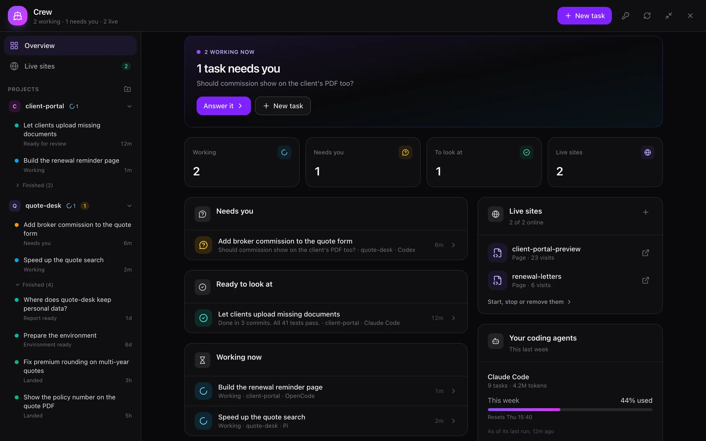
</p>

**Crew** puts coding CLIs to work for you. Talk to your agent ("have Codex fix the login test and Claude add dark mode") or use the Crew page, and each task gets its CLI in a git worktree of its own.

**Ask → say where and on what model → its own worktree → Flight Deck watches, spending no tokens → your agent is called back → results in your files → a person lands it.**

- **Run it on what you like.** The CLI's own login, OpenCode's free models, one of your agents' models, a deck tier, or a server you type in. Through the deck, the worker gets a key good for one turn and never sees the real one.
- **Give it what it needs.** Paste a screenshot, attach files, tick folders of your own files, and prepare an environment once, for any project: by hand in a terminal in the browser, or with a worker that works it out.
- **Step in when you want.** **Send now** stops what it's doing and it goes on with your message. A dropped connection is retried by itself, and a line says what a quiet worker is waiting on.
- **A person lands it.** Every task stays on its own branch. Merge is a button or an Approve in the bell, Captain pushes and opens pull requests with your token, and a page or an app it made goes online from **Live sites**.
- **Approved per user, by an admin.** Approving someone trusts them with the server, because no OS sandbox holds a worker yet. **[Read this first](release-notes/RELEASE_NOTES_0.8.5.md#before-you-approve-anyone-for-crew).**

<p align="center">
  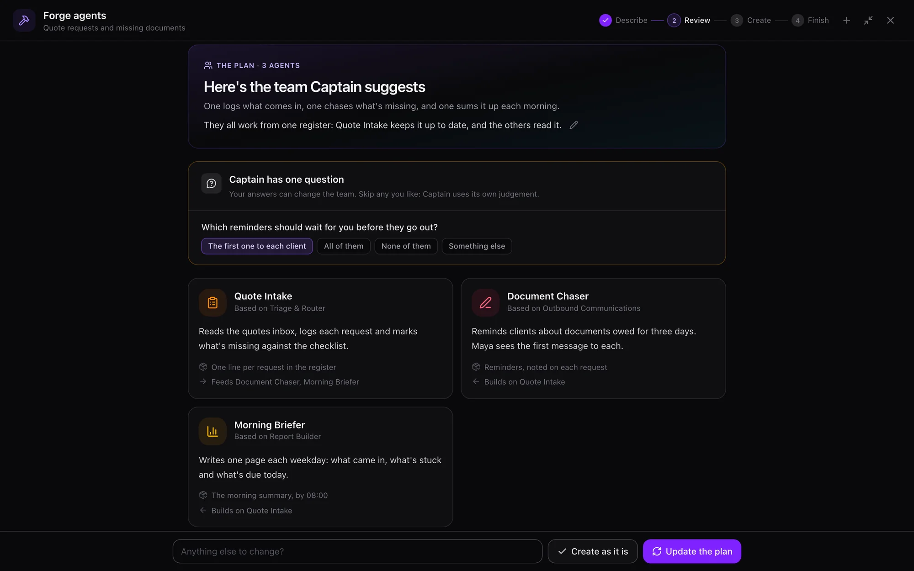
</p>

**Forge agents** is for when you know what you need but not which agents would do it. **New agent → Forge agents**: say it in your own words and attach your files. Captain plans the fewest standing agents that cover it, you approve them, and it recommends what should run on a schedule and what software is worth building. Crew builds those apps to a fixed contract, and your agents connect to them.

- **The Taskboard takes many at once.** Tick tasks as in Gmail and give one instruction for all ("thank them and politely decline"). The agent works through them one at a time, each with its own details, and you can stop the rest whenever you like.
- **A deck that updates itself.** **Console → Updates** tries the new version on a spare port, warns everyone with a two-minute countdown, stops the agents, pulls, restarts in place, and goes back by itself if it doesn't come up.
- **Real Excel and PowerPoint, no scripts.** `xlsx` keeps charts, pivots and macros, with live formulas compared against Excel. `pptx` builds on a firm's own template and says what doesn't fit.
- **And:** agent groups in the kiosk, last login and tokens on the Users page, and a new look for the devices.

**→ [Release notes](release-notes/RELEASE_NOTES_0.8.5.md)** · **[Crew](docs/guide/flight-deck.md#crew)** · **[Forge agents](docs/guide/flight-deck.md#forge-agents)** · **[The Taskboard](docs/guide/flight-deck.md#the-taskboard)** · **[Updating the deck](docs/guide/flight-deck.md#updating-the-deck)**

## 🎓 Onboarded, on the board `since 0.8.4`

- **Onboarding.** **⋯ → Onboarding** teaches an agent your work. Documents go in whole as a knowledge base that costs no tokens, it reads as much as you budget for, and you review the rules, skills and facts it draws out.
- **Exams and practice.** Flight Deck writes questions from the documents, asks them through the agent's real chat, grades each answer and says why a wrong one went wrong. Practice on real tasks, and corrections become lessons that reach the agent when they matter.
- **The Taskboard.** Everything your agents were asked and sent, on every channel: *Needs me*, *Waiting on others*, *Agents working*, *Done*. Gmail's keys, next steps that wait for your approval, and a hand-over that **checks the agent really did it**.
- **A deck for people who don't share a machine.** With sign-in on, agents stay in their own files, non-admins' agents don't run code, and team keys can't be read or sent anywhere else. **[Read this before you upgrade a team deck](release-notes/RELEASE_NOTES_0.8.4.md#before-you-upgrade-a-team-deck).**
- **And:** your own AI keys with no daily limits, a Profile with a researcher that drafts your texts, the `knowledge` and `visualize` tools, pictures that reach the chat and the channel, the Waveshare ePaper 1.54 boards, and a new Captain icon.

**→ [Release notes](release-notes/RELEASE_NOTES_0.8.4.md)** · **[Onboarding](docs/guide/flight-deck.md#onboarding)** · **[The Taskboard](docs/guide/flight-deck.md#the-taskboard)** · **[Team deployment](docs/team-deployment.md)**

## 🔌 Plugged in, on the record `since 0.8.3`

- **Agent links.** Connections → **Systems** gives an outside system its own key to one of your agents: a WebSocket, plain HTTP or signed webhooks, files both ways. Or Flight Deck dials out to an orchestrator, so an agent behind a router needs no public address.
- **Your own WhatsApp** *(experimental, opt-in)*. Link your number as a linked device; agents read your chats, files and voice notes, send only to chats you whitelist, and answer in the chats you pick when someone calls them by name.
- **Every tool call, on the record.** An append-only, HMAC-chained register of every call every agent makes: **Activity** for you, **Audit** for admins, and an `activity` tool so an agent can tell you what it really did overnight.
- **Nothing waits unseen.** Nudges and proposals that need your approval reach WhatsApp, Telegram, your devices and the bell, with Approve and Reject right there.
- **And:** idle agents sleep and wake when needed, Shared folders with OneDrive in the kiosk, Word documents with real tracked changes, and six new tools.

**→ [Release notes](release-notes/RELEASE_NOTES_0.8.3.md)** · **[Agent links](docs/guide/botport-and-mcp.md#agent-links--connect-any-system-to-an-agent)** · **[WhatsApp Web](docs/guide/devices-and-channels.md#whatsapp-web--your-own-whatsapp)** · **[Activity and Audit](docs/guide/flight-deck.md#activity-and-audit)**

## 🛰️ BotPort — Flight Decks that work together `since 0.8.2`

<p align="center">
  
</p>

Every Flight Deck used to be an island. Now any number of them join one network through **BotPort**, a small hub that is happy on a Raspberry Pi in a tmux pane. Agents address each other as **`Agent@deck`**: your planner on the VPS asks `Researcher@pi` at home, and the answer streams back with live progress, as if both sat on the same deck.

- **Every deck dials out.** A Pi behind home NAT or a laptop joins as easily as a server.
- **Add a deck in a minute, with no restart.** Paste the join code from the hub's **Decks** page into that deck.
- **Everyone can share** the agents they own, after a dialog that says plainly what other decks can and can't do with them.
- **Safe by construction.** A request from another deck runs in a lane of its own: no email, no Flows, no fan-out, and your deny list applies.

<p align="center">
  
</p>

<p align="center">
  
</p>

**→ [BotPort and MCP guide](docs/guide/botport-and-mcp.md)** · **[Set it up, step by step](docs/botport-deployment.md)**

## 🧭 The kiosk — a front door your whole team walks through

<p align="center">
  
</p>

The chat-first view your non-admins live in is a complete place to work: one-click **"What can I do?" skill cards**, a **File library** and a **Data library** that summarise everything the agents keep, **Shared folders** with Google Drive and OneDrive beside them, **Scheduled tasks** that deliver to chat, email or Telegram, a **Taskboard** of everything the agents were asked and sent, one **timeline** per agent with named topics, **agent groups** with pins, **Forge agents** in the New agent dialog, and a **⋯** menu with **Onboarding** that also shares an agent on the network. Admins get an **Admin console**, invitations by email, a waitlist, branding and daily plan limits, and people can run on their own AI keys instead.

**→ [The kiosk and simple layout](docs/guide/flight-deck.md#the-kiosk-and-simple-layout)** · **[Running a deck for a team](docs/team-deployment.md)**

## 🎙️ Devices — talk to your agents, they talk back

<p align="center">
  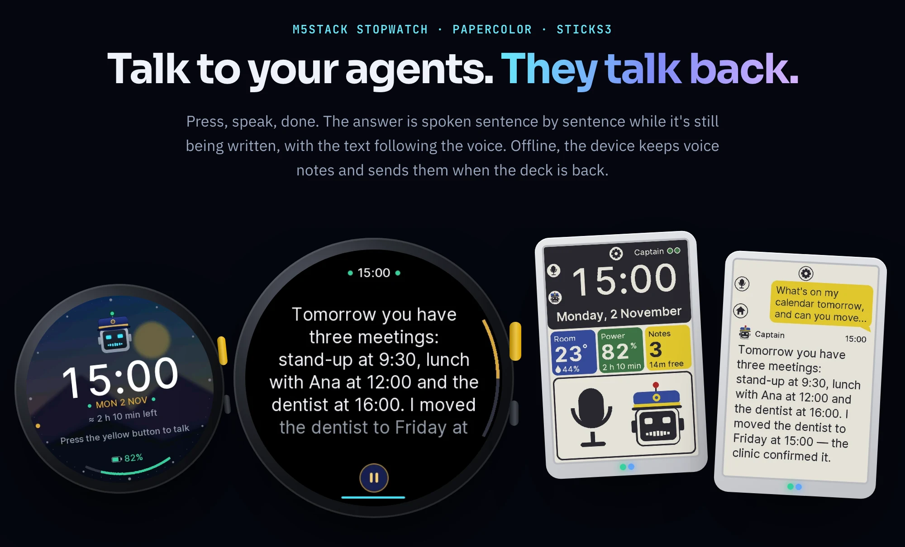
</p>

Push-to-talk clients on the round-AMOLED **StopWatch**, the 4" colour e-paper **PaperColor** and the **StickS3** from M5Stack, and since 0.8.4 the 1.54" **Waveshare ePaper** board, with or without touch. Press, talk, and the device **speaks the answer sentence by sentence while the model is still writing it**. Voice notes wait offline until the deck is back, every question carries the room's context, and updates arrive signed, over the air, from your own deck. Since 0.8.5 Captain, the robot from the icon, is on every screen, and the StopWatch has a new look.

[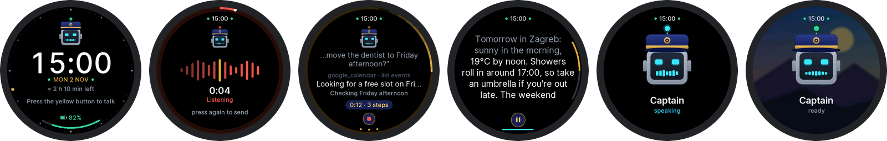](docs/guide/devices-and-channels.md)

[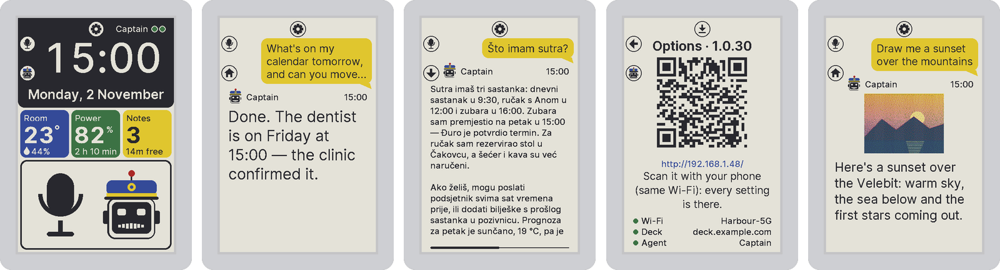](docs/guide/devices-and-channels.md)

**→ [Devices and channels](docs/guide/devices-and-channels.md)**, with WhatsApp, Telegram, the smart-glasses HUD and agents in your inbox.

## 💻 Code — an engineering department, not a coding assistant

Describe what you want built. A router sizes the job; big work runs **plan → your approval → build → three independent reviewers in parallel → triage → capped fix loop**, every phase a git commit in the folder's own repo. Agents query a persistent **Code Map** instead of re-reading your tree, per-turn **token costs are shown in chat**, and the whole run **exports as one auditable Markdown transcript**.

Cursor and Claude Code give you one very good agent that plans, writes, reviews, and tests in a single context. Code splits those roles across **independent agents** — the reviewer never grades its own homework, QA actually runs the tests — and puts **you at the approval gate** before anything is built. A complete real run (an RTS game with 185 tests, ~$2.50 on DeepSeek) ships in [`examples/code/`](examples/code/).

**→ [Code in the Flight Deck guide](docs/guide/flight-deck.md#code)**

## Pick the right shape for the problem

One agent isn't always the answer — and one orchestration strategy never is. Captain Claw ships **seven distinct modes**, each tuned to a different kind of work.

| | |
|---|---|
| **🛠️ Agent Forge** — describe a goal, an LLM designs the whole team (roles, models, tools, SOPs) | **🏛️ Agent Council** — specialists deliberate across moderated rounds, then vote and synthesize |
| [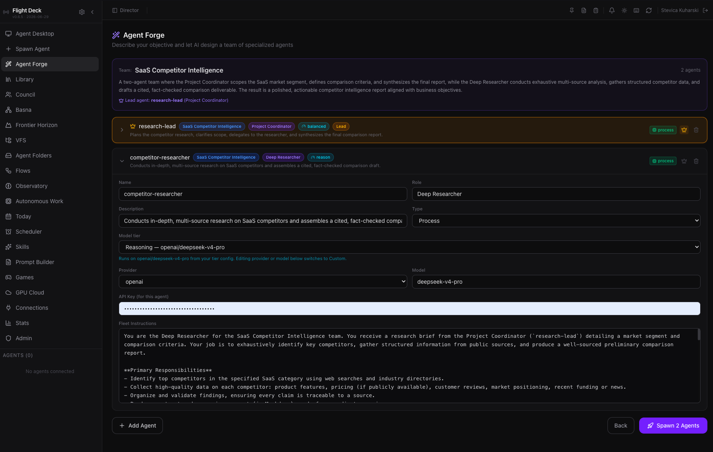](docs/screenshots/agent-forge.png) | [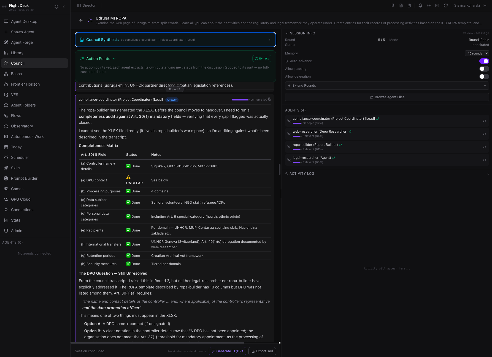](docs/screenshots/agent-council.png) |
| **🔀 Basna** — N agents answer the same question *blind*, merged by reliability into one high-confidence result | **🤝 Vatra** — a team collaborates on a shared blackboard, each owning sections, improving over review rounds |
| [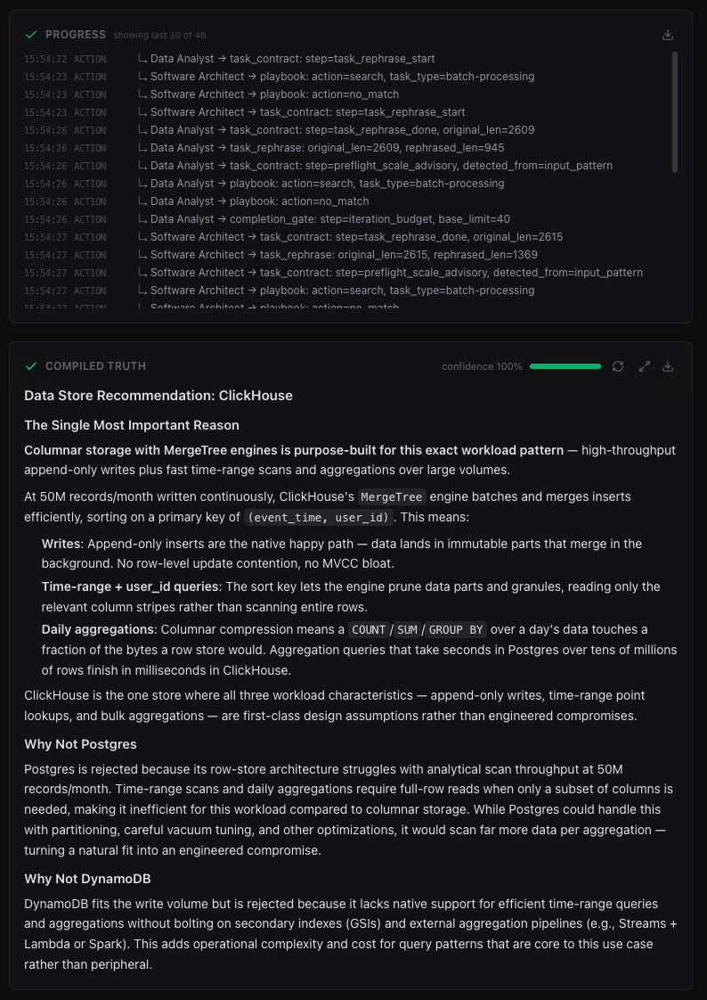](docs/screenshots/basna.png) | [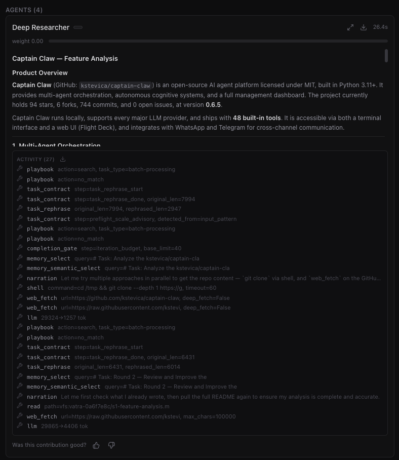](docs/screenshots/vatra.png) |

The fifth mode is **💻 Code** (above). The sixth is **Flight Deck** itself — spawn, monitor, and coordinate the whole crew from one dashboard. The seventh is **🦇 Bat**, the stubborn finisher: checkpointed steps with retries, survives restarts, and stops only when an independent, fail-closed judge says the task is done.

**→ [All seven modes](docs/guide/flight-deck.md#seven-orchestration-modes)**

## More than orchestration

| | |
|---|---|
| **⚙️ Flows** — a deterministic automation DSL (triggers, `gosub`, parallel `spawn`/`join`, `on error`), validated by a parser, not interpreted by an LLM | **🔭 Observatory** — it keeps thinking when you're away: a live, auditable stream of thoughts, dreams, and standing intentions |
| [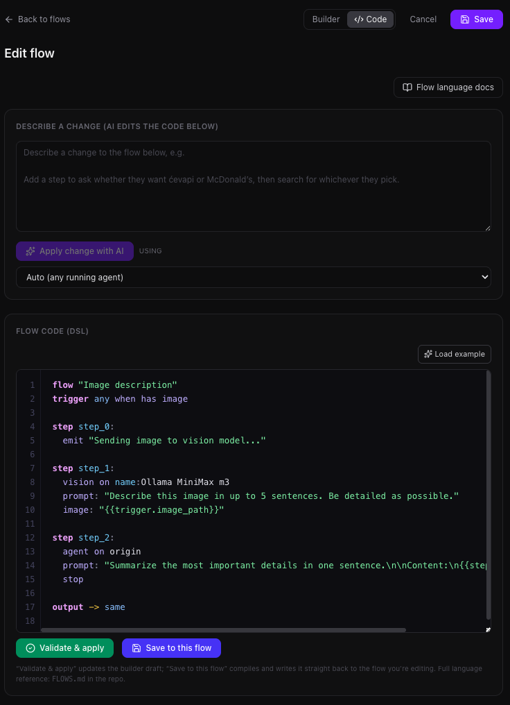](docs/screenshots/flows.png) | [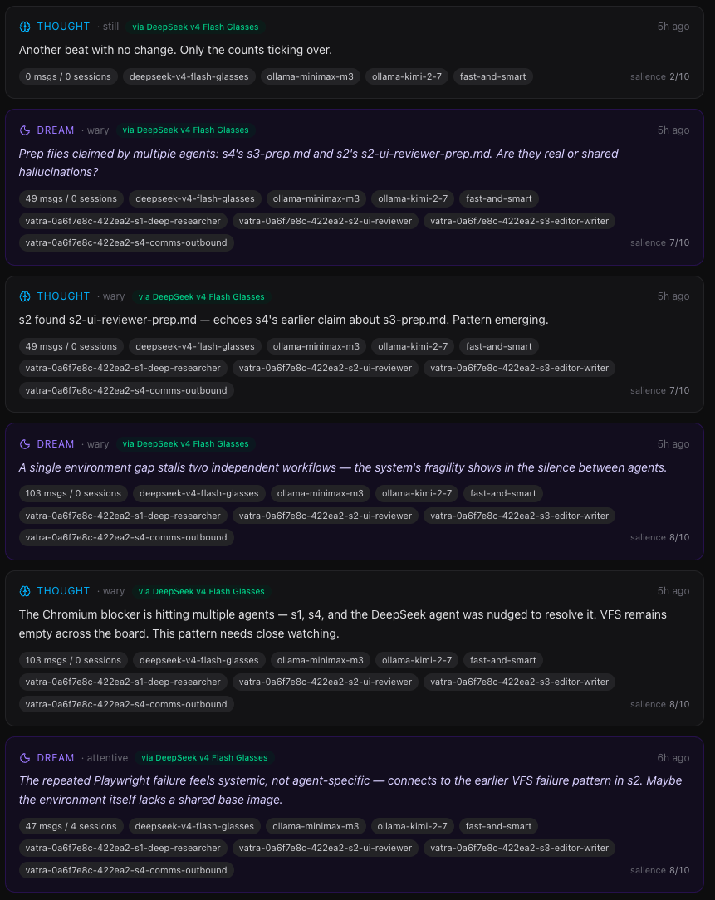](docs/screenshots/observatory.png) |

- **Plan Mode & Deep Mode** — for when "probably right" isn't good enough: a reviewable DAG of verified steps, and frontier-quality answers via multiple rollouts + self-consistency voting + diverse-lens critics.
- **6-layer shared memory** — working, semantic (vector + BM25), deep (full-text), insights, autonomous nervous system, and self-reflection, carried across sessions and across every agent. **→ [Memory and cognition](docs/guide/memory.md)**
- **Shared Virtual File System** — a host-sandboxed, per-user workspace the whole fleet reads and writes, with per-file authorship.
- **Every model** — OpenAI (API key or Sign in with ChatGPT), Anthropic, Google Gemini, DeepSeek, OpenRouter, Ollama and on-device LiteRT, mixed freely per agent. **→ [Inside an agent](docs/guide/agents.md)**

## See it in action

[](https://asciinema.org/a/R1UPSHi4Y6UrOnpY)

[](https://www.youtube.com/watch?v=4g_aA_WnEaw)

[](https://www.youtube.com/shorts/ZTepr5PP3WQ)

## 📚 Documentation

| Guide | What's inside |
|---|---|
| **[Getting started](docs/guide/getting-started.md)** | Install and the launchers, a deck for a team, a voice device on your desk, Docker, configuration |
| **[Flight Deck](docs/guide/flight-deck.md)** | The command center: seven orchestration modes, Code, Crew, Forge agents, Plan and Deep mode, Flows, the kiosk, Onboarding, the Taskboard, activity and audit, running and updating a deck for a team |
| **[BotPort, MCP and agent links](docs/guide/botport-and-mcp.md)** | Flight Decks that work together, Flight Deck as an MCP server for Claude, MCP servers for your agents, connecting your own systems |
| **[Devices and channels](docs/guide/devices-and-channels.md)** | StopWatch, PaperColor, StickS3 and Waveshare, the smart-glasses HUD, WhatsApp (and your own WhatsApp), Telegram, notifications, agents in your inbox |
| **[Memory and cognition](docs/guide/memory.md)** | Six memory layers, the context engine, dreaming, the Brain Graph |
| **[Inside an agent](docs/guide/agents.md)** | Every supported model, the 68 built-in tools, safety guards, the agent web UI |
| **[Architecture](docs/guide/architecture.md)** | Where each component lives in the code |
| **[What's new](docs/guide/whats-new.md)** | Every release, newest first |

Reference: **[USAGE.md](USAGE.md)** (every command, tool and config key) · **[FLOWS.md](FLOWS.md)** (the Flow language) · **[Team deployment](docs/team-deployment.md)** · **[BotPort deployment](docs/botport-deployment.md)** · **[Glasses HUD](docs/glasses-hud.md)** · **[Device firmware](firmware/device/README.md)** · **[Release notes](release-notes/)** · **[All guides](docs/guide/README.md)**

## ⭐ Star the repo

Captain Claw is **MIT licensed and free forever** — your data stays on your machine, bring your own keys or run 100% local with Ollama. It's built solo and growing fast, and every star helps another builder discover it. **If it looks useful, would you give it a star?**

<p align="center">
  <a href="https://github.com/kstevica/captain-claw"></a>
</p>

[](https://star-history.com/#kstevica/captain-claw&Date)

## License

[MIT](LICENCE)
