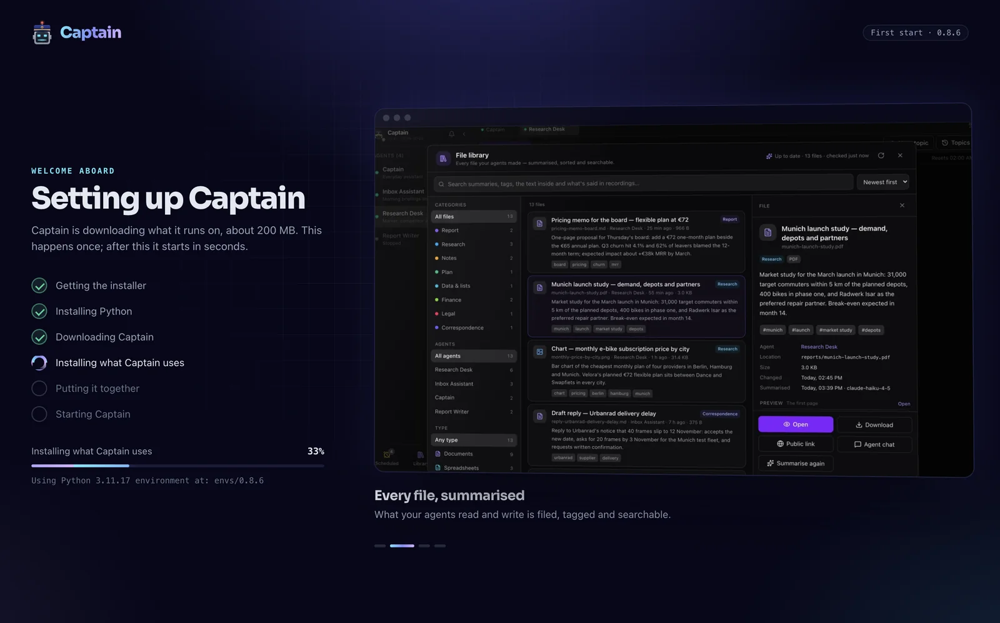

# Captain Claw v0.8.6 Release Notes

**Release title:** Ship's Log
**Release date:** 2026-11-04

0.8.5 gave your agents hands. 0.8.6 keeps a log of everything they did on their own, and
starts making them measurably better at your real work.

**The Line** is one timeline per person for everything the deck and your agents did on their
own: scheduled tasks, Autonomous Work, finished runs, proposals, fleet changes. The bell keeps
only what needs you. Ask an agent about any item, hand it one, approve a proposal right there,
and choose how much of it reaches WhatsApp, Telegram or an agent's chat.

**Captain Swarm** keeps improving one number you care about. It tries several ideas at once,
measures every attempt itself on cases it keeps sealed, and keeps only a gain bigger than the
noise. Triage rules learned from what you actually did with your mail, the best result for a
real task found in rehearsal where nothing is sent or bought, the best document or research for
a brief, or any repository with a measuring command. **Admins only, while it's being tested.**

**131 archetypes.** 31 Generalists and 100 Specialists, for work and for your own life, with
disclaimers where the advice is legal or medical. An admin can **generate the company's own**
and publish them to everyone.

**Captain on your desktop is 75 MB**, down from 2.5 GB. It installs the rest on its first start
and **updates itself** from then on, going back by itself if a new version doesn't come up.

Also in 0.8.6: **Bat finishes for real**, with checks it runs itself, fix rounds, parallel steps
and one budget for the whole run; **Forge agents** builds the team size you ask for; a new **New
agent** picker; **Crush** as a fifth Crew worker; and **Keenable** web search with no key.

27 pull requests, two days after 0.8.5.

**Restart Flight Deck, then every agent.** See [Upgrading](#upgrading). **Bat runs with no cap
now stop at $50**: see [Changed](#changed).

## Highlights

### The Line: one log for everything that happened on its own

Every person has a **Line**: **Line** in the full layout's navigation, a Line row above the agents
in the kiosk, and a button next to the bell on a phone. It holds what the deck and your agents
did without being asked in a chat:

- scheduled tasks' results (failures need you; a skipped run isn't posted),
- Autonomous Work's actions and Taskboard hand-overs (failures need you),
- plan steps, coding sessions, and Basna, Vatra and Bat runs that answered on another channel,
- proposals and questions waiting for you, nudges, payments to look at, and fleet changes.

**The bell is now only what needs you**, with waiting items on top, and says *Nothing waits for
you* when that's so. Shares, sends, accepted invites and successful runs moved to the Line.

**Read it like a conversation.** Day groups, real headlines, an unread dot and **Failed**,
**Needs you** and **Approve?** pills, with a filter strip. Open an item beside the list (or in its
place on a phone); Markdown is rendered and **Approve** / **Reject** sit right there. Items that
belong together are one **thread**: a hand-over and its answer, or everything about one Taskboard
task. A fullscreen button gives it the whole window.

**Talk to it.** One composer at the bottom: pick any of your agents and ask it something, or hand
it the open item with *Look into it*, *Draft a reply* or *What should I do?*. A sleeping agent is
woken. The answer lands on the Line and opens by itself; only your words count as the request, and
the item is quoted as information. An agent writes email only when you ask it to.

**Choose what reaches you.** **Connections → Notifications** (or **Channels** on the Line): WhatsApp
and Telegram each at **Everything**, **Needs you** or **Off**, and one agent's chat at a level of its
own, as a note that never starts a turn. Nothing rings twice, and quiet hours let only nudges
through to phones. A **Daily summary** is a scheduled task, *Summary of your Line*, at the time you
pick, to the agent's chat and Telegram or email.

**Agents read it too.** A read-only `line` tool (`news`, `recent`, `search`, `read`), and on your
own turns a one-line count of what's new since the last one: numbers, never the items' text. A
shared agent's members never get either.

**Agents no longer hear about the fleet.** The "[Flight Deck] Agent X has joined the fleet" message
that interrupted running agents is gone; fleet changes go to the owner's Line.

### Captain Swarm: measurably better, proven before anything is kept

**Captain Swarm** (next to Bat in the full layout; in the kiosk menu and tool tiles) runs one
objective: a number to improve, cases to measure it on, and what an attempt may change. Each round
it tries several ideas at once, **measures every attempt itself** on the open cases and on held-out
cases it keeps sealed, and **keeps a gain only if it beats the noise**, the held-out cases confirm it
and a reviewing model passes it. It stops at its target, its budget, its time or attempt limit, or
when it stalls. Five kinds of run:

| Kind | What improves | What you get |
|---|---|---|
| **Rules from your habits** | An agent's triage rules, against what you really did: which mail you answered (**Build from my Gmail**), which invitations you accepted (**Build from my calendar**) | **Teach these rules to** the agent, as lessons, on your click after the run |
| **Best result for a task** | The answer to a real task ("the cheapest flight that…"), tried in **rehearsal**: reads run, but mail, messages, bookings and payments are recorded as intents, not done, and a browser stops at Submit, Buy, Pay and Send. Captain opens every page an attempt claims | **Carry it out** once, as an ordinary Bat run, on your click |
| **Write or research** | A document or research for a brief, graded against a checklist from the brief and a sealed one. Captain opens every cited source | **Save to my files** (`vfs:captain-swarm/`) |
| **Any repository** | A number a command prints, with the paths an attempt may edit; each idea is tried by a Crew worker in its own branch | **Open a pull request** from the best branch. Captain never merges |
| **Mrav eval** | Mrav's small-model scores | A branch, as above |

**It learns.** Each objective has a **Kind of task**, and lessons are kept per kind: what won and
what lost in earlier runs feeds the next one, and **What it learned** lets you forget any lesson. A
proposer only ever hears whether the sealed cases confirmed a gain, never what's in them. A one-task
run's approach can be **saved as a playbook** on one of your agents.

**Caps are in tokens**, typed as `80M` or `500k`, with dollars shown as "about $x". Defaults per run
and per attempt: Write or research 100M / 15M, Best result for a task 50M / 10M, Rules from your
habits 60M, code 200M.

**An agent can propose a run** with the `captain_swarm` tool; it waits for your **Go** and rings the
bell. A user agent confined to its files never gets the tool.

**Admins only for now.** Every page and the tool answer "Captain Swarm is open to this deck's admins
only" to anyone else; with sign-in off, the one local user is the admin. Computer use (Phase 5) and
the last phase are parked.

### 131 archetypes, and your company's own

- **Three kinds**, as tabs in New agent, the Library and Console → Archetypes: **Company**, **Generalists**
  (31) and **Specialists** (100: 76 for work across 17 families, 24 for your own life). Company comes
  first everywhere, once an admin has published some.
- **Longer instructions**, with the hard limits first.
- **Disclaimers** on 23 archetypes (legal 12, health 6, clinical 5), shown in the picker, under the
  chat (shared agents too) and in the Console. Console and both editors have **Kind** and
  **Disclaimer** fields.
- **Generate a group** (admins, Console → Archetypes): say who it's for, attach documents, choose how
  many (up to 12, or let Captain decide). Captain drafts a group with its family, icon and colour and
  writes each archetype's instructions; you edit anything, then **Publish to everyone**. Nothing reaches
  anyone before that. Up to 300 per deck. It runs on the admin's own Reason tier, and the deck puts its
  own crisis and disclaimer rules under the hard limits.
- **Planners see a shortlist**: the generalists, your own archetypes and up to 15 matched specialists,
  about 8,000 characters instead of 43,000.

No lawyer or clinician has reviewed the new instructions or the disclaimer wording yet, and
generating a group hasn't been run on a real model.

### Captain on your desktop: 75 MB, and it updates itself

The desktop app was 2.5 GB, and a fix meant downloading all of it again. **Captain** for macOS is now
a **75 MB** download: the window, without Python inside.

  

- **The first start installs the rest**, about 200 MB, with a page that shows each step beside a short
  tour: a pinned uv, Python 3.11, every package Captain uses from a lock that pins each one by its hash,
  and Captain itself, which carries both the backend and the Flight Deck page. Half a minute on a fast
  line. It needs the internet that once.
- **Updates come in place.** **Check for Updates…** (the Captain menu on a Mac, Help elsewhere; it also
  looks a minute after start and every six hours) installs the new version beside the running one,
  test-starts it on a spare port with an empty data folder, and switches on **Restart Now** or the next
  time you open it. A release whose packages didn't change downloads only its 15 MB.
- **It goes back by itself.** If a new version doesn't come up after the switch, the app starts the one
  before and says why, and doesn't offer the failed one again unless you check yourself.
- **It's called Captain**, with the cap Bot on its start screen and its own install window. Window
  storage and logs carry over; an older **Captain Claw** app stays in Applications until you delete it.
- The old self-contained app is one flag away (`./build-desktop.sh --full`), for a machine that must
  start without the internet.

Windows and Linux builds are written but untested, and the app is unsigned, as before. Building it and
publishing a release for it: [README_BINARY.md](https://github.com/kstevica/captain-claw/blob/main/README_BINARY.md#2-desktop-app-electron).

### Bat finishes for real

- **Checks it runs itself.** A Bat run pins an acceptance contract (a file exists, contains, doesn't
  contain, a command passes, a model judges) and runs it. Commands and the project's own tests run for
  admins' runs, or with sign-in off. Reviewers read the run's folder and prefer a model the workers
  don't use.
- **A refusal becomes work.** What the checks or reviewers find becomes fix steps for the next round.
  The same check failing two rounds running stops the run as no progress, and 8 rounds is the ceiling.
- **It asks you at a stalemate.** When the checks pass but the reviewers keep refusing, the Bat page
  asks you: accept it as it is, or stop.
- **Steps run in parallel**, up to 3 (`FD_BAT_MAX_PARALLEL`). A step list you wrote still runs in order.
- **One budget for the whole run**: what workers spend while they work, and what any Basna, Vatra, Code
  or Crew run they start spends, counts toward the cap.
- **Fixed:** the step instructions never reached the workers; `ask_human` steps were marked done; the
  Basna relay took over Bat steps; a failed spawn leaked an agent slot; broken contract JSON threw every
  check away; a cancel could be overwritten while judging.

### New agent and Forge agents

- **New agent, redesigned** in the console's look, with a fullscreen button: families in a side rail
  with counts, an icon per archetype, a detail pane that's never empty, and **Forge agents** as a card.
  Type, Enter to the name, Enter to create; arrows move between cards. An empty search offers Forge
  agents.
- **Team size** in Forge agents: **Captain decides, up to 8**, or **At most 1** to **At most 12**. A
  number you ask for now wins, and Review says how many agents Captain would have added when a limit
  left work out, rather than dropping it silently.

### Smaller things

- **Crush in Crew.** Charm's Crush works beside Claude Code, Codex, OpenCode and Pi, on your provider
  keys, your own model or a model through the deck. An admin installs it, and someone already approved
  for Crew needs it ticked. Steps show a few seconds late, token counts read low, and its licence is
  FSL-1.1-MIT, not open source. A provider address with `$` or a backtick is refused for every CLI.
- **Keenable web search, no key needed** (`tools.web_search.provider: keenable`; `KEENABLE_API_KEY` for
  higher limits). Brave stays the default. Thanks to [KGKallasmaa](https://github.com/KGKallasmaa).
- **A roomier Profile**: about half again as wide, with its panels side by side.
- **PDF export works without Pango.** WeasyPrint needs Pango from the system, so on a Mac without
  Homebrew, and in the old desktop app, both PDF exports failed. They now print with Chromium instead,
  with scripts off and nothing fetched from the machine itself.

With `line` and `captain_swarm`, that makes **70 built-in tools** per agent.

### What's still open

- **Captain Swarm** has run end to end on synthetic mail and throwaway decks. A real owner's triage
  baseline, a real **Carry it out** (it would be a real purchase) and a gain kept live on code are still
  to come. Address checks have a small DNS-rebinding window.
- **The Line** has been tried on scratch decks; a real agent answering on it, or receiving a channel
  item, hasn't.
- **Bat's dollar cap** and reviewers on another model are proven in tests only; local models with no
  price don't count toward it.
- **Forge agents** planning 9 to 12 agents, and generating archetypes, haven't been run on a real model.
- **Crush** has run on a scripted model only.

## Upgrading

1. **Each Flight Deck** — pull, and `pip install .` where Captain Claw is installed non-editable, or use
   **Console → Updates**. There are no new Python packages; `glob2`, which nothing used, is gone.
2. **Restart Flight Deck, then every agent.** Agents need the restart for `line`, `captain_swarm`, the
   rehearsal guard, the Line's channel items and Crush in `crew`. Then hard-refresh every browser.
3. **Bat** — a run that doesn't name a cap now stops at $50. Set `FD_BAT_DEFAULT_LLM_USD=0` to keep the
   old "no ceiling".
4. **For Crush** — install it on the deck's host (`npm install -g @charmland/crush`) and tick it for
   the people approved for Crew.
5. **The desktop app** — this release is the first the new app installs from. Download **Captain** once;
   from then on it updates itself. An older **Captain Claw** app can be deleted: both use the same data.

Devices need nothing: firmware stays **0.20.4** / PaperColor B **1.0.31**. BotPort hubs need nothing
new: 0.8.6 keeps protocol 2, and BotPort's code is unchanged since 0.8.2.

### Changed

- **The bell lists only what needs you.** Shares, sends, accepted invites, successful runs and nudges
  are on the Line.
- **Agents aren't told when the fleet changes**; their owner's Line is.
- **Bat runs with no cap stop at $50** (`FD_BAT_DEFAULT_LLM_USD`, 0 for none). Code's contract patterns
  now match line by line (`re.MULTILINE`), as Bat's do.
- **Archetype shelves** are `generalist`, `specialist` (was `focused`, still read), `personal` and
  `group-*`. Three archetypes (deal-screener, ic-prep, portfolio-watch) moved to the Generalists.
- **The desktop app is Captain** (`Captain.app`), installed and updated as above.
- **PDF export** falls back to Chromium where WeasyPrint can't load.

### New settings

| Setting | Default | What it does |
|---|---|---|
| `FD_BAT_MAX_PARALLEL` | `3` | Bat steps running at once |
| `FD_BAT_DEFAULT_LLM_USD` | `50` | The cap for a Bat run that doesn't name one; `0` means none |
| `FD_CAPTAIN_SWARM_DISABLED` | off | Turns Captain Swarm's supervisor off |
| `FD_CAPTAIN_SWARM_MAX_RUNS` | `1` | Captain Swarm runs at once per person |
| `FD_CAPTAIN_SWARM_MAX_LANES` | `4` | Attempts at once in a run (1–8) |
| `FD_CAPTAIN_SWARM_PER_SITE` | `1` | Attempts at once on one site or account (1–4) |
| `FD_CAPTAIN_SWARM_MEASURE_PARALLEL` | `1` | Measurements at once (1–8) |
| `FD_CAPTAIN_SWARM_BROWSER` | on | Lets Captain open pages in headless Chromium for its own checks (public addresses only) |
| `FD_CREW_CRUSH_BIN` | found on `PATH` | Where Crush is, if Flight Deck can't find it |
| `tools.web_search.provider: keenable` | `brave` | Keenable search; `KEENABLE_API_KEY` for higher limits |
| *WhatsApp*, *Telegram*, *Agent chat* (Connections → Notifications) | as before | **Everything**, **Needs you** or **Off** for the Line on each |
| *Daily summary* (the Line) | off | A *Summary of your Line* task at a time you pick |
| `CAPTAIN_CLAW_MANIFEST_URL` (desktop app) | the latest release | Where the desktop app looks for releases |
| `CAPTAIN_CLAW_RUNTIME_DIR` (desktop app) | `~/Library/Application Support/Captain/runtime` on a Mac | Where it installs Python and each version |

New stores create themselves on start: `line_items` and `line_cursors` for the Line (the old bell table
is copied in once and still written for this release), `bat_children` and new columns for Bat, and
`captain_swarm.db`. No manual migration.
