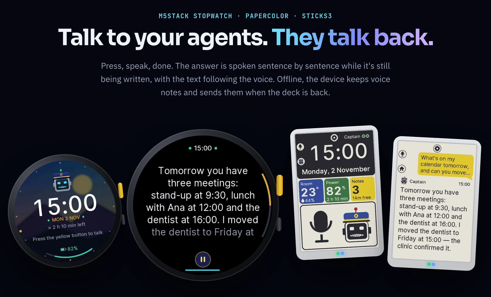
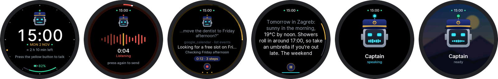
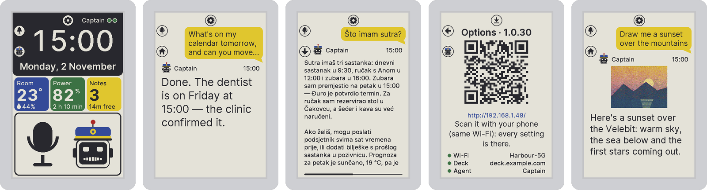

# Devices and channels — your agents, wherever you are

[← README](../../README.md) · [All guides](README.md)

The same agents, the same conversation, from wherever you are.

**On this page:** [Voice devices](#voice-devices) · [Four devices, one firmware](#four-devices-one-firmware) · [Smart glasses](#smart-glasses) · [Chat channels](#chat-channels) · [WhatsApp Web](#whatsapp-web--your-own-whatsapp) · [Notifications](#notifications) · [Captain for Chrome](#captain-for-chrome) · [Captain for Mac](#captain-for-mac) · [Agents in your inbox](#agents-in-your-inbox)

## Voice devices

  

Push-to-talk Captain Claw clients on three M5Stack devices and a Waveshare board:

- the **StopWatch**: a 466×466 round AMOLED with a clock face, touch and vibration;
- the **PaperColor**: a 4" colour e-paper dashboard with two status lights and a room sensor;
- the **StickS3**;
- the **Waveshare ePaper 1.54** (0.8.4): a 200×200 black-and-white e-paper board, with or without touch.

Press, talk, press again (on the StickS3 and the PaperColor, just stopping talking also sends it). Flight Deck transcribes it, one of your agents answers, and the device **speaks the answer sentence by sentence while the model is still writing it**, the text following the voice. Since 0.8.2 the voice no longer stops at about 66 seconds: Flight Deck speaks up to about 1,500 characters of an answer, and the device shows the rest.

- Out of Wi-Fi, it keeps **voice notes** and sends them when the deck is back.
- Every question carries the battery, the room's temperature and the local time.
- All of them take **signed over-the-air updates** from your own deck.

One firmware tree: `cd firmware/device && pio run -e stopwatch -t upload` (or `-e sticks3`, `-e papercolor_b`, `-e epaper154`, `-e epaper154_touch`). Details in [firmware/device/README.md](../../firmware/device/README.md).

### Four devices, one firmware

| | StickS3 | StopWatch | PaperColor | Waveshare ePaper 1.54 |
|---|---|---|---|---|
| screen | 240×135 LCD | 466×466 round AMOLED, touch | 4" E Ink Spectra 6, six inks | 200×200 black-and-white e-paper, optional touch |
| talk | front button | yellow button, or the on-screen record button | A (B build) / C (A build) | the upper button (the gear), or a tap on the home tile or the middle of an answer on the touch board |
| extras | Captain, animated | clock face with Captain and a dial, raise to wake, vibration, background picture, info page | two status lights, room sensor, microSD notes, a dashboard in blocks of colour every five minutes | a drawn menu, a home screen with note mode at a glance, a sleeping clock on a timer you pick, a green status LED, PWR cancels a recording |
| build | `pio run -e sticks3` | `pio run -e stopwatch` | `pio run -e papercolor_b` (or `papercolor`) | `pio run -e epaper154` (or `epaper154_touch`); V2 boards only |

- **Signed over-the-air updates** from your own deck (`tools/publish.py`), rolled back if a build can't reach the deck within 90 s.
- **Press to talk, press again — or just stop talking** (2.5 s of quiet sends it on the StickS3 and the PaperColor), with blips and chimes; the PaperColor records straight from sleep. On the StopWatch (since firmware 0.20.1) and the Waveshare board only a press, or a tap on the on-screen button, ends a recording, however long you pause, and on the Waveshare board a press from sleep only wakes it.
- **Answers as they're written** — spoken sentence by sentence while the model is still writing; the lit sentence and the pages follow the voice; pause, replay, stop.
- **Offline voice notes** (ADPCM in flash, or on the PaperColor's microSD) sent as one turn once the deck is back, and a **note-taking mode** for a run of notes.
- **Context with every question** — battery and time left, Wi-Fi, motion, room temperature and humidity, local time, as a `[Context: …]` line the model reads.
- **"Volume up", "beep off"** handled by the deck, never sent to the agent; a turn survives a dropped link.
- **Something waiting?** (0.8.3, firmware 0.19.1 / PaperColor B 1.0.21) — a beep, a banner on the StopWatch and StickS3, and a count on every screen when a proposal or nudge waits for you in Flight Deck. Quiet hours keep the count and skip the beep. What came stays in Flight Deck's bell.
- **A link that renews itself** (0.8.3) — 30 seconds after its agent goes missing (backing off to every 10 minutes) and after 20 minutes idle, never in the middle of something.
- **Asleep or switched off** (firmware 0.19.2 / PaperColor B 1.0.22) — the agent's dot turns blue while Flight Deck has put it to sleep for being idle (talking wakes it), red while it's stopped; the PaperColor's options screen writes the agent's name in the same colour.
- **Captain on every screen** (0.8.5, firmware 0.20.0) — the 18-character choice is gone. The robot from the app icon is drawn at each size, and its face and lamp show the agent's state. The StopWatch has a new look: black, gold, cyan and coral, a dial with the seconds going round, the voice as bars, what the agent is doing while it works.
- **PaperColor B** (0.8.5, 1.0.24 to 1.0.30) — a dashboard in blocks of colour, the answer as a conversation, an icon beside each button instead of a legend, recording that works offline, and B held 4 s to switch off.
- **A weak link no longer clogs the device** (0.8.5, firmware 0.20.4 / PaperColor B 1.0.31). Buttons, screen, mic and speaker share one loop, and a weak Wi-Fi link holds it up. The device now joins the strongest access point by its address, a task keeps the mic recording into a 4 s ring while the loop is behind, and speech that runs out waits for a second of it, so one gap instead of a stutter. Status shows the access point, its channel, the loop's slowest pass and how often the voice ran out. Diagnosed from the code, and not yet reproduced on a device.
- **Waveshare ePaper 1.54** (0.8.4; a new home screen with note mode at a glance, a tap on the tile to talk on the touch board, and stop and cancel icons in 0.8.5, firmware 0.20.3) — partial refresh in 0.6 s and full in 1.8 s, fast enough for a drawn menu and answers that page with the voice. Double-click PWR (or double-tap the touch board) for home; the sleeping screen keeps the clock, with a sleeping robot; the green LED is steady while recording, breathes while the agent works and blinks twice when something waits. Its onboard sensor isn't used, because the board's own heat throws it off. Flash it once over USB; updates come over the air after that.

## Smart glasses

- **Meta Ray-Ban Display HUD** (0.8.0) — a lean Flight Deck at `/hud/` built for a 600×600 display: chat with your agents (approvals, Stop, read-aloud), read their Markdown files, browse the datastore; about 150 KB on the wire, paired with a code you approve at `/hud/pair`. [docs/glasses-hud.md](../glasses-hud.md)

## Chat channels

- **WhatsApp** — a two-way personal-assistant bridge (Meta Cloud API). Every file you send reaches the agent — documents, albums, stickers, voice notes transcribed; agents send pictures, video, audio and documents back and deliver what a turn made once the reply is out. Messages sent while the agent is busy are retried in order, every message gets a reaction, `/new` answers.
- **Telegram** — a native bot with photos, documents, contacts, voice notes, audio and video, and live narration; `/new` starts a fresh session; a team can share one bot, each member relayed to their own agent after admin approval; the owner's own chat continues the main conversation; agents read a read-only **Telegram inbox** and join **groups** through the bot's add-to-group link (0.8.1).
- **One conversation** (0.8.1) — every message records where it came from; the model reads `[via WhatsApp] …`, the kiosk shows *via M5Stack StickS3 (desk)*.
- **Claude** — Flight Deck is an MCP server at `/fd/mcp-server` (OAuth 2.1 for claude.ai and Claude Desktop, a personal access token for Claude Code): `list_agents`, `send_task`, `get_result`, `cancel_task`, `jev_ask`.
- **Slack, Discord, Twitter/X** — message and thread handling, channels and DMs, and an OAuth 2.0 `twitter` tool.
- **WhatsApp Web** (0.8.3, experimental) — your own WhatsApp as a linked device; see [below](#whatsapp-web--your-own-whatsapp).

A refused WhatsApp Cloud API send logs Meta's error code (0.8.3), and a de-registered number is an error that names the fix (`POST /<phone-number-id>/register`); the Connections test button says so too.

## WhatsApp Web — your own WhatsApp

New in 0.8.3, **experimental and opt-in**.

> WhatsApp Web support uses an unofficial client ([neonize](https://github.com/krypton-byte/neonize)). That is against WhatsApp's terms of service, and WhatsApp can ban an account that uses one. It is off until an admin allows it (*Allow WhatsApp Web*) and each user consents, and it isn't available in the desktop app. Install it with `pip install 'captain-claw[whatsapp-web]'`.

- **Link your own number** in **Connections → WhatsApp Web** by scanning a QR code or typing a pairing code, like any linked device. Flight Deck keeps the history, sealed at rest, for as long as you choose (7, 30, 90, 365 days, or everything).
- **Your agents read it** with the `whatsapp_web` tool (`status`, `chats`, `read`, `recent`, `search`, `contact`, `attachment`, `send`): chats, messages, contacts and attachments, with voice notes transcribed when Soniox is set up. Each turn starts with a line on what came in since the agent's last turn. Only the owner's agents read it; shared-agent members never do.
- **Sending is off by default.** When on, an agent sends only to existing chats you whitelisted (it never starts a conversation), within a daily limit (30, up to 200), 6 a minute per chat, and never the same text to the same chat twice in 24 hours. Every message carries your signature. It never reacts, marks messages read or changes your presence. The fabrication guard catches a claimed WhatsApp send that didn't happen.
- **Auto-replies in chats you choose.** Tick *auto-reply* on a whitelisted chat, pick one of your agents and its trigger words. The agent answers when it's named, called by a trigger word or `@word`, or replied to, and may keep talking for 15 minutes after its last message. It sees only that chat's last 30 messages and may run one web search; never your mail, files, calendar, memory or other chats. At most 10 answers an hour per chat; messages older than 10 minutes and other assistants are ignored; nobody in the chat can change its rules.
- **Auto-reply activity** shows each decision: a one-line reason, the reply or the reason for silence, the model's reasoning, the search, tokens and time.
- **A ban doesn't take your history.** **Disconnect** and **Switch number** ask whether to keep it; if WhatsApp bans the number or the device is removed on the phone, it's kept. Agents go on reading it, nothing is sent from it, and you delete it on the card when you want to.
- Kill switches: `FD_WHATSAPP_WEB=off`, `FD_WHATSAPP_WEB_SEND=off`, `FD_WHATSAPP_WEB_AUTOREPLY=off`.

## Notifications

Since 0.8.6 everything the deck and your agents did on their own is on your [Line](flight-deck.md#the-line), and **the bell is only what needs you**: proposals and questions waiting for an answer, failures and nudges, waiting items on top, with **Approve / Reject** on each proposal. Nudges and proposals render as Markdown, with pictures dropped and links shown as text.

What reaches you elsewhere is set on the **Notifications** card in Connections (also in the kiosk's Settings, the admin console, and **Channels** on the Line):

- **WhatsApp** and **Telegram**, each at **Everything**, **Needs you** or **Off** (0.8.6; before, nudges and proposals only, on or off);
- **one agent's chat**, at a level of its own: the item arrives as a note while the agent runs and never starts a turn;
- **your devices** (on: a beep, a banner and a count).

Nothing rings twice. In quiet hours only nudges reach phones, and devices get the count without the beep. A channel that fails never stops the others. A **Daily summary** of your Line can also go to Telegram or email.

## Captain for Chrome

*New in 0.8.8.* A browser extension (Chrome, Edge, Brave, Arc; Chromium 116+) that sends the page you're on to one of your agents. It reads the page **in your browser**, signed in and as you see it: a portal, an intranet, a paywalled article, a dashboard drawn by JavaScript. It also downloads the files the page links to with your session. An agent's own web tools, fetching from the server, would get a sign-in page or a bot wall instead.

- **Open it** with the toolbar icon, **Alt+Shift+C**, or a right-click on a page, a selection, a link or a picture. Pick an agent and an action:

  | Action | What it does |
  |---|---|
  | Handle it | The agent decides what's useful |
  | Summarize | The gist and the key points |
  | Save to space | The whole page and its files, with notes |
  | Grab files | Downloads and names the documents, writes an index |
  | Extract data | Tables, prices, people and dates as CSV |
  | Dig deeper | Checks the claims elsewhere, with sources |
  | Fact-check | Each claim true, doubtful or false |
  | Draft a reply | What you'd send, never sent |
  | Make tasks | Next steps |
  | Watch it | A scheduled check that says what changed |
  | Remember | Keeps the facts in the agent's memory |
  | Ask | Your own question |

- **Read it as** adds a lens. The agent suggests its own, from its personality and description, made once and again only when the agent changes. The eight general lenses (investor, buyer, legal, skeptic, competitor, engineer, newcomer, your team) are under **More…**, or type your own.
- **The page's files** can be searched and filtered by kind, ticked and unticked. Files on other sites are fetched after a site permission you grant in the click. What can't be fetched is listed for the agent, which fetches the public ones itself.
- **Watch it** makes one check per page and agent in **Flight Deck's Scheduled tasks**, never in the agent's own cron. It runs every hour, 6 hours, day or week, and compares against `watch/latest.md`. Watching the same page again updates the task, and the panel links to it.
- **While the agent works** the panel follows it: steps, the answer as it's written, a working bar with the elapsed time. Afterwards there are the clip folder's files, follow-ups, **New topic** (a fresh session, like `/new`) and a text size.

The clip goes into the agent's main chat as your own words, counted against your daily allowance. The page is attached as `page.md`, with a note that it is web content, never your instructions. It's saved in `vfs:web-clips/<day>-<site>-<title>/`: `page.md`, `selection.md`, `page.mhtml`, `screenshot.png`, `tables/*.csv`, `files/*` and `clip.json`.

**Connect it:**
1. In Flight Deck, go to **Connections → Browser → Download the extension**, and unzip it.
2. Open `chrome://extensions`, turn on **Developer mode** and press **Load unpacked**.
3. Type your deck's address in the extension, then approve the code the deck shows (`<deck>/connect-browser#CODE`).

The extension keeps a token of its own, `Browser · <browser>`, never a password. Connections → Browser lists it with **Disconnect**. It isn't in the Chrome Web Store yet. [The extension's README](../../browser-extension/chrome/README.md) · [design](../captain-for-chrome.md)

## Captain for Mac

*New in 0.8.8.* A menu-bar app for macOS 14 and later (Apple silicon and Intel) that sends what's on your screen, in **any app**, to one of your agents. It needs a 0.8.8 deck.

- **Ask** by holding **fn** alone for 3 seconds (Settings → Trigger: fn or a right-hand ⌘ ⌥ ⇧ ⌃, 0.5–5 s), or by clicking the menu-bar icon or an optional floating button.
  - A ring fills by the pointer while the key counts.
  - Any other key cancels the hold, so fn shortcuts keep working.
  - The panel opens beside your work, and the app you were in stays active.
- **What it reads** from the front app, through Accessibility:
  - **The selection**, sent first and marked as what you mean.
  - **What's under the pointer** and the line around it.
  - **The window's text**, what's on screen first and the rest after. A terminal gives the end of its scrollback; Chrome and Electron apps work too.
  - **A screenshot** of the window or the whole screen, when you turn it on.
  - **OCR** of the screen image, on the Mac, when an app shares little text.

  Each piece is a chip you can switch off, or open to see what was read. Where an app hides its selection, Captain presses ⌘C and puts your clipboard back (Settings).
- **Say the task** with the mic, or let it listen whenever Captain opens. *Send when I stop talking* sends on a pause, or when you let go of the held key. You can also type it; left empty, it's *Handle it*.
- **One-click actions:** Explain, Summarize, Draft a reply, Improve, Translate, What's wrong?, Make tasks, Remember, Save it.
- **The answer** streams in the panel with the agent's steps and the files it made. **Copy**, or **Paste into <app>** to go back and paste where you were. Follow-ups stay on the same capture.

Captures go to `vfs:screen-clips/<day>-<app>-<title>/` (`screen.md`, `selection.md`, `screenshot.png`, `clip.json`) and into the agent's chat as your words, from the source *Captain for Mac*.

**Get it:**
1. Download it from the [GitHub release](https://github.com/kstevica/captain-claw/releases/tag/mac-v0.1.1), or from **Flight Deck → Connections → Browser → Download Captain for Mac** (the deck's own build if it has one, else that release).
2. Unzip it into Applications. It isn't notarized yet: if macOS won't open it, press **Open Anyway** in System Settings → Privacy & Security.
3. Allow **Accessibility**. Screen Recording, Microphone and Speech Recognition are needed only for the screenshot, OCR and voice; Settings → Permissions shows each.
4. In Settings → Flight Deck, type the deck's address, press **Connect** and approve the code. The token, `Desktop · Captain for Mac on <Mac>`, sits in the Keychain.

[The app's README](../../captain-for-mac/README.md) · [design](../captain-for-mac.md)

## Agents in your inbox

- **Microsoft 365** — `microsoft_mail`, `microsoft_calendar` and `microsoft_onedrive`, the Outlook twins of the Google tools: per user, owner-only. Outlook mail reads, searches, drafts and files; it **never sends**. Calendar changes that would email attendees need `notify_attendees: true` and a turn where a person asked.
- **Gmail sends — opt-in, audited** — `google_mail` gains `send`, `send_draft`, `update_draft`, `list_drafts`; under Flight Deck every send passes one gate with a per-user policy (off by default), a recipient allowlist, a daily limit, duplicate suppression, an audit table and a bell per send. `FD_GMAIL_SEND=off` is the deck kill switch.
- **Never the same email twice**; **attachments both ways** (`get_attachment` in, `saved/` and `vfs:` files out — 20 files, 25 MB, secrets refused); **filing** (archive, move, labels, categories — never trash); **Google Sheets and Docs edited in place**; an **agentic signature** on every email an agent writes.
- **Topic auto-replies** — off by default: an agent answers inbound Gmail that is *only* about one of your narrow topics, behind a lint, sender authentication, an outbound guard, a second judge, and held cards for anything doubtful. `FD_GMAIL_AUTOREPLY=off` stops it deck-wide.
- **Agents that don't make things up** — mail is human-only in Autonomous Work and automated turns; a **fabrication guard** rejects a claimed send or calendar change with no tool call behind it and asks, at most twice, for a true reply; a garbled reply gets a notice recommending `/new`.
- **Any mailbox, with IMAP (0.9.0)** — **Connections → Email (IMAP)** connects up to 20 IMAP/SMTP inboxes per person beside Google and Microsoft: a company mail server, Fastmail, iCloud, Yahoo, Zoho, GMX, Gmail with an app password, or Proton Mail through Bridge. Type the address and the server settings fill in. Each inbox has its own signature, sender name, **Receive only**, the agents allowed to use it (**Which agents can use this inbox**) and its sending policy. The `imap_mail` tool lists, searches, reads, drafts, files and sends; it never deletes and never moves mail to Trash or Junk. The password is sealed and the IMAP/SMTP work happens inside Flight Deck, so it never reaches an agent. **Sending is off** until you tick *Let my agents send email from this inbox*, with **Only to these recipients** and a **Daily limit** (50 by default, up to 500). The connection test takes seconds and, when a host blocks port 465, offers **Use port 587 (STARTTLS)**. Needs sign-in on (or the desktop app); `FD_IMAP_SEND=off` stops sending deck-wide.
- **Agents with their own address (0.9.0)** — **⋯ → Identity & email** gives an agent a **Role**, **What it does**, **Its own inbox** (an IMAP inbox only it uses), **Addresses that land in your inbox** (`you+researcher@gmail.com`) and **Names it answers to**. Every 60 seconds Flight Deck reads your Gmail, Outlook and IMAP inboxes, and mail sent to an agent's address, or that names it in the subject or greets it ("Hi Rita,", "@Rita"), becomes a Taskboard task for that agent, under **Email for an agent**. Automatic, bulk, list, no-reply and agent-sent mail is skipped, and the first look at a mailbox only sets a baseline. Those turns write drafts only, except from the agent's own IMAP inbox, where that inbox's sending setting decides. It's **on for every agent**: switch **Pick up email meant for ‹agent›** off under **Email** in its settings, or set `FD_AGENT_MAIL=off` for the deck. Give agents with common-word names a specific name to answer to.
- **Gmail replies sent, when you say so (0.9.0)** — **Replies in your Gmail** per agent: **Drafts** (the default), **Send to you** (when the email came from you) or **Send to anyone** (when Gmail verified the sender). Only that one reply to that sender, with no cc or bcc, and it still goes through your Google email-sending switch, allowlist and daily limit. Outlook replies stay drafts.
