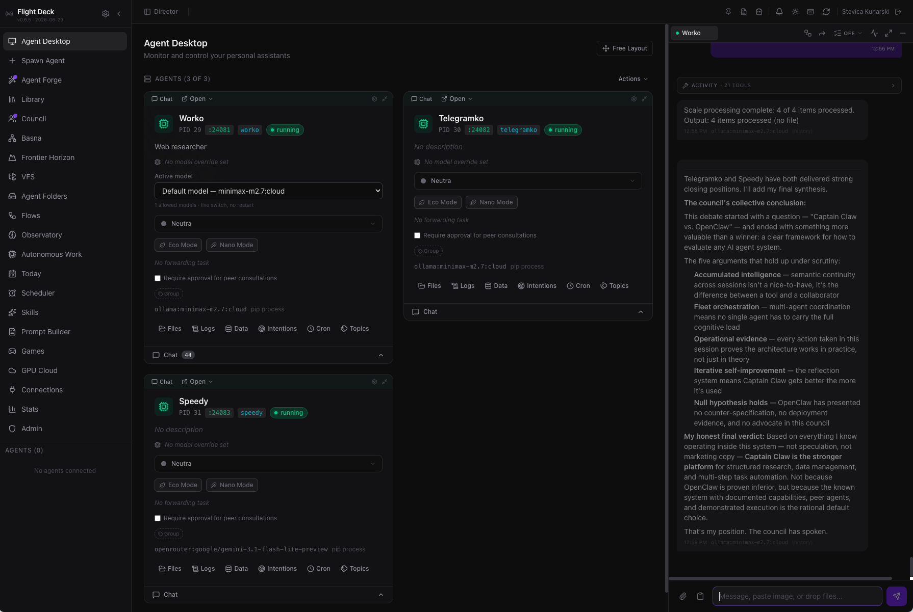
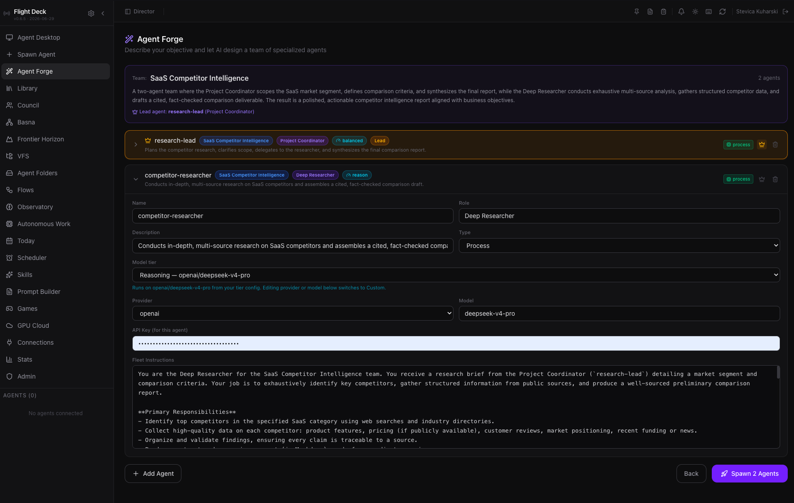
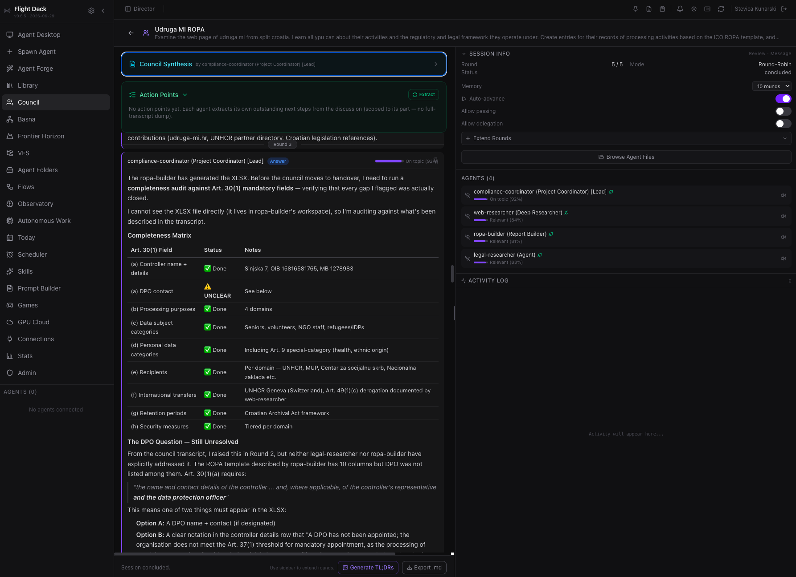
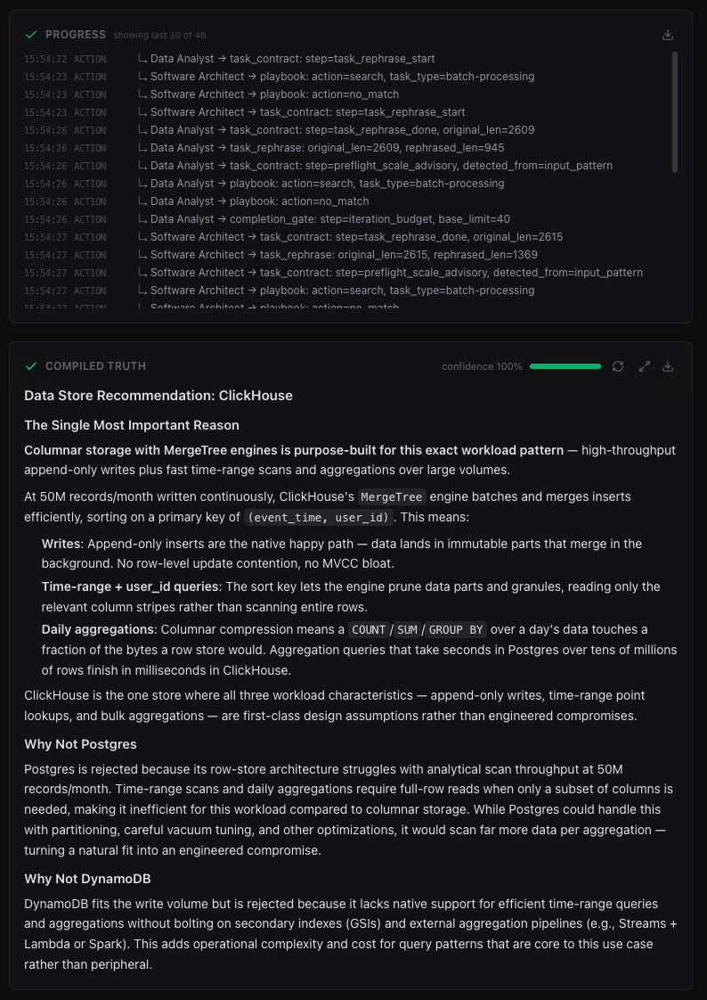
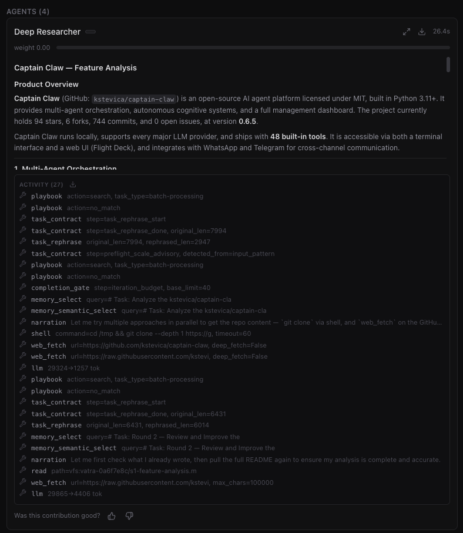
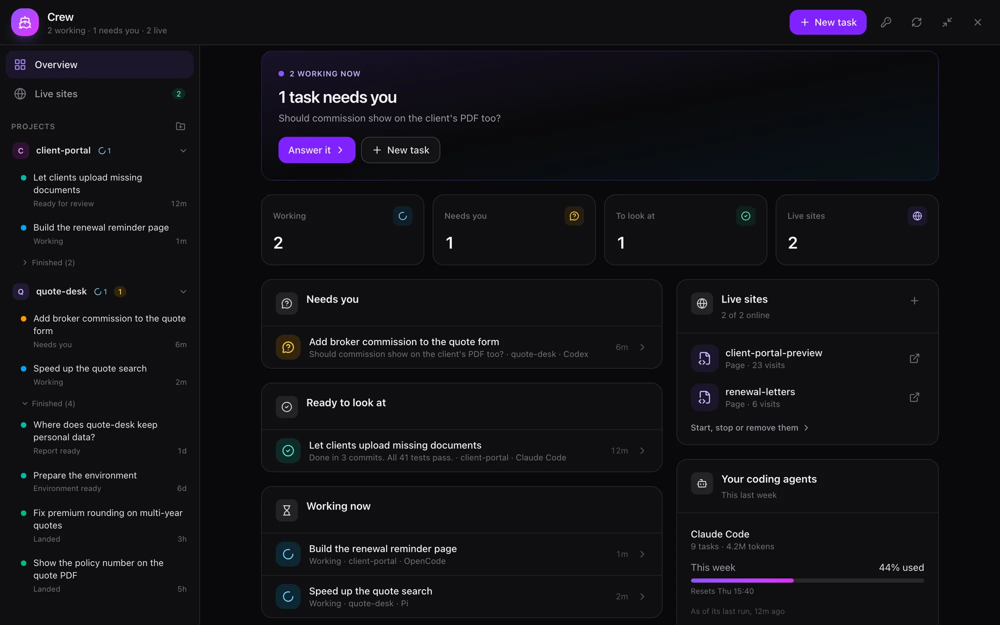
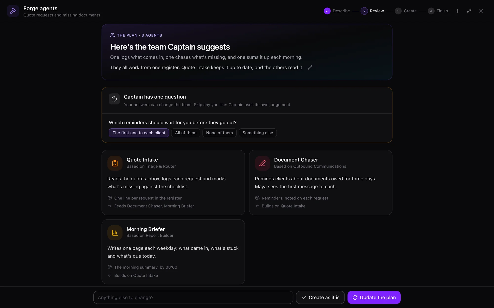
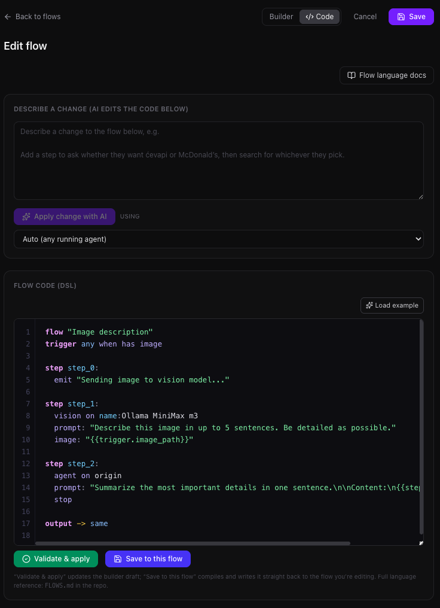
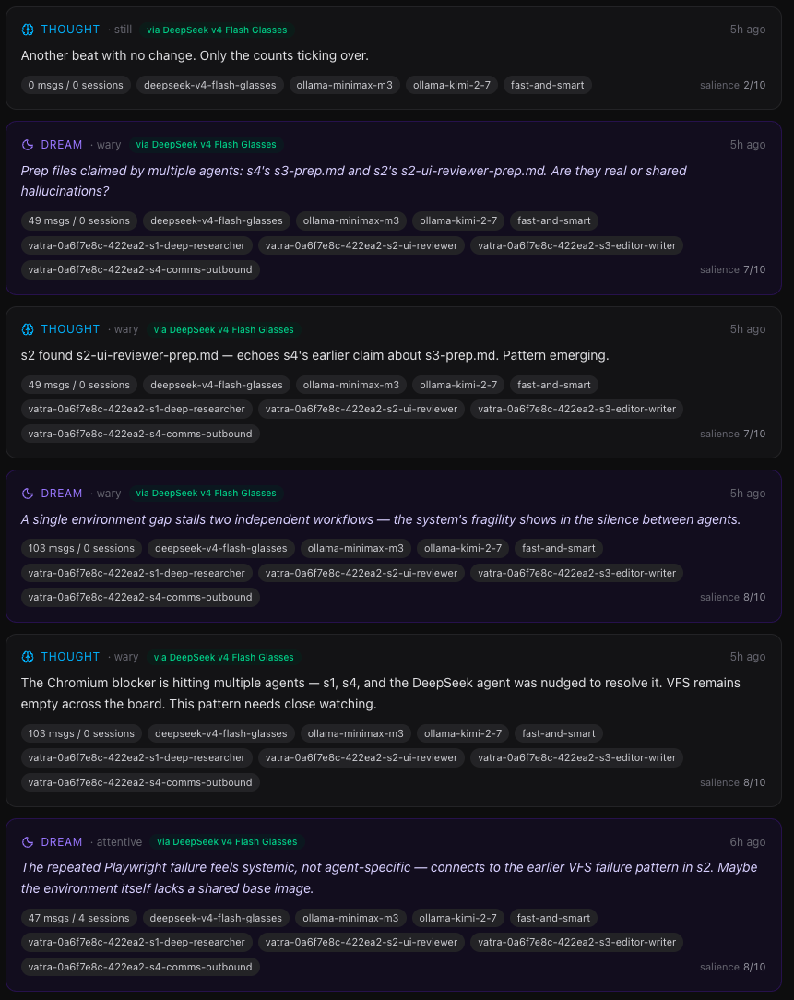
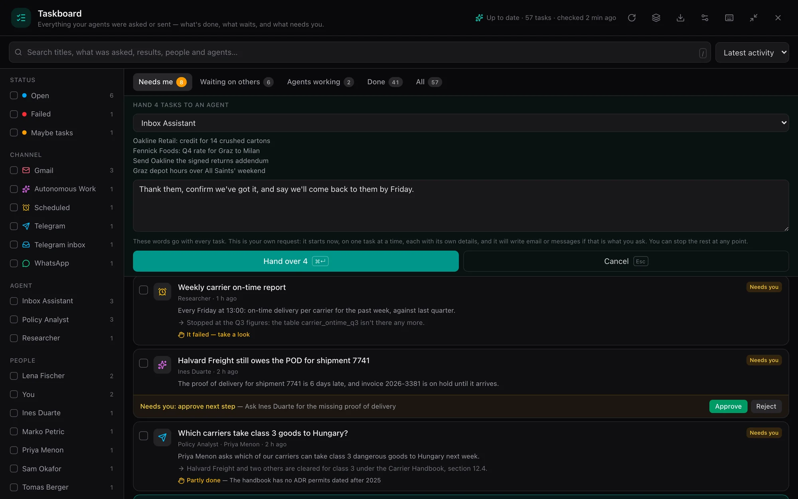

# Flight Deck — the multi-agent command center

[← README](../../README.md) · [All guides](README.md)

A full management dashboard for running teams of AI agents. Spawn, monitor, configure, and coordinate agents from a single UI.

<p align="center">
  
</p>

```bash
flight-deck        # http://0.0.0.0:25080   (alias: captain-claw-fd; add --simple-chat for a kiosk)
```

**On this page:** [Seven orchestration modes](#seven-orchestration-modes) · [Code](#code) · [Crew](#crew) · [Forge agents](#forge-agents) · [Plan and Deep mode](#plan-and-deep-mode) · [Orchestrator / DAG mode](#orchestrator--dag-mode) · [Flows and the Observatory](#flows-and-the-observatory) · [Running the fleet](#running-the-fleet) · [The kiosk and simple layout](#the-kiosk-and-simple-layout) · [Onboarding](#onboarding) · [The Taskboard](#the-taskboard) · [Your own AI keys and Profile](#your-own-ai-keys-and-profile) · [Activity and audit](#activity-and-audit) · [Running a deck for a team](#running-a-deck-for-a-team) · [Updating the deck](#updating-the-deck) · [Idle agents sleep](#idle-agents-sleep)

## Seven orchestration modes

One agent isn't always the answer — and one orchestration strategy never is. Captain Claw ships **seven distinct modes**, each tuned to a different kind of work.

| | |
|---|---|
| **🛠️ Agent Forge** — describe a goal, an LLM designs the whole team (roles, models, tools, SOPs) | **🏛️ Agent Council** — specialists deliberate across moderated rounds, then vote and synthesize |
| [](../screenshots/agent-forge.png) | [](../screenshots/agent-council.png) |
| **🔀 Basna** — N agents answer the same question *blind*, merged by reliability into one high-confidence result | **🤝 Vatra** — a team collaborates on a shared blackboard, each owning sections, improving over review rounds |
| [](../screenshots/basna.png) | [](../screenshots/vatra.png) |

The fifth mode is **💻 Code** (below) — a plan-gated, independently-reviewed engineering pipeline. The sixth is **Flight Deck** itself — spawn, monitor, and coordinate the whole crew from one dashboard. The seventh, new in 0.8.0, is **🦇 Bat** — the stubborn finisher: checkpointed steps with retries, survives restarts, and stops only when an independent, fail-closed judge says the task is done.

- **Agent Forge** — Describe a business goal in plain text. An LLM designs a specialized team with roles, tools, operating procedures, and a lead coordinator. Review, customize, and spawn the entire team in one click. Since 0.8.5 the kiosk's **[Forge agents](#forge-agents)** goes further, to a standing team with its schedules and its software.
- **Agent Council** — Structured multi-agent deliberation. Run brainstorms, debates, reviews, or planning sessions with 2-N agents. Each agent self-scores suitability, chooses actions (answer, challenge, refine, broaden), and responds in moderated rounds. A moderator synthesizes conclusions; all agents vote. Export as markdown minutes.
- **Basna** — A network-source ensemble. Describe a task and a router picks the smallest set of specialist archetypes, spawns them fresh, runs them blind and in parallel, and merges their answers weighted by each archetype's learned reliability (synthesizing only on disagreement). Attach files/images, edit each agent before the run, watch a live progress log, and download generated files. Reliability is learned per-archetype so routing improves over time.
- **Vatra** — A collaborative team on a shared blackboard: a lead splits the work, each agent owns sections, reads what the others wrote, and improves it over review rounds; a reporter assembles the deliverable. Since 0.8.0 workers run until they're done, under an in-turn context governor, reading a rule-built run map.
- **Code** — An agentic coding studio. A router sizes each request; big jobs run plan → your approval → build → three independent reviewers → triage → capped fix loop, each phase a git commit with diff timeline and rollback. Agents query a persistent Code Map instead of re-reading the tree; runs work on VFS folders or your own linked local repos, with per-turn token costs in chat and full process export.
- **Bat** (0.8.0) — A durable "stubborn finisher": plans, runs checkpointed steps with retries, survives restarts, and stops only when an independent judge says the task is done — behind a hard safety floor and a start gate for email, spending and accounts. Since 0.8.6 it **finishes for real**: it pins an acceptance contract and runs the checks itself (commands and tests for admins' runs), turns a refusal into fix steps for the next round (8 rounds at most, and two rounds failing the same check stop it), asks you at a stalemate, runs independent steps in parallel (`FD_BAT_MAX_PARALLEL`, 3), and counts the whole run's spend, child runs included. **A run with no cap stops at $50** (`FD_BAT_DEFAULT_LLM_USD`, 0 for none).

## Code

Describe what you want built. A router sizes the job; big work runs **plan → your approval → build → three independent reviewers in parallel → triage → capped fix loop**, every phase a git commit in the folder's own repo. Agents query a persistent **Code Map** (symbols + architecture, git-hash-fresh) instead of re-reading your tree; per-turn **token costs are shown in chat**; the whole process **exports as one auditable Markdown transcript**. Works on fresh folders or **your existing local repos linked in** — on any models you configure, including a cheap implementer with a premium reviewer.

Cursor and Claude Code give you one very good agent that plans, writes, reviews, and tests in a single context. Code splits those roles across **independent agents** — the reviewer never grades its own homework, QA actually runs the tests — and puts **you at the approval gate** before anything is built. Self-hosted, model-agnostic, no lock-in. A complete real run (an RTS game with 185 tests, ~$2.50 on DeepSeek) ships in [`examples/code/`](../../examples/code/). Details in [RELEASE_NOTES_0.7.0.md](../../release-notes/RELEASE_NOTES_0.7.0.md) and [USAGE.md](../../USAGE.md#code--the-agentic-coding-studio-new-in-070).

## Crew

New in 0.8.5: Crew lets Captain run **Claude Code, Codex, OpenCode and Pi** for you, and since 0.8.6 **Crush** too (an admin installs it, and someone already approved for Crew needs it ticked; its steps show a few seconds late and its licence is FSL-1.1-MIT). Code above is Captain's own pipeline, with its own agents. Crew is the other way round: your agent is the first mate, and those CLIs do the work. Talk to your agent ("have Codex fix the login test and Claude add dark mode") or open **Crew** from the sidebar, or in the kiosk from the agent column or **Settings**.

<p align="center">
  
</p>

**How a task flows.**

1. **Ask.** Pick a CLI and say what's wanted. **Change the code** (a `ship` task) works on a branch; **Only look, and report** (a `scout` task) changes nothing. Asking twice while the first is active is the same task.
2. **Say where.** **A project**, **a repository address** or, for admins, **a folder here**. Crew clones an address itself in the background, and `crew action=clone` gets one here with no work and no tokens.
3. **Say what it runs on.** *Its own* login or OpenCode's free models, *an agent's model*, *a deck tier*, or *enter one*: an address, a model, a context size and a key, for this task only. Through the deck, the CLI needs no login: it gets a key good for its current turn, and the real one stays on the deck. Those tokens count like an agent's: only what missed the prompt cache, plus output.
4. **Give it what it needs.** Paste or attach any file, on New task and in any later message (50 MB each, 30 files or 200 MB a task). Tick **folders of your files**: **Read** is its own copy, remade each turn; **Read and write** is your real folder, at once, with no undo. Drive and OneDrive aren't offered.
5. **It works.** Flight Deck watches without spending tokens, and a worker outlives a deck restart. **Send now** (Enter) stops what it's doing and it goes on with your message; **After this turn** (⌘/Ctrl+Enter) waits. A dropped connection shows as a grey note while the CLI retries, and if it gives up Captain starts it again from where it stopped, up to three times. After a quiet minute a line says what it's waiting on.
6. **It finishes.** Your agent is called back on the channel you asked from. Results reach your VFS at `vfs:crew/<project>/<task>/` (`report.md` and `files/`), and the **Files** tab shows them.
7. **A person lands it.** Every task works on its own branch and never pushes. **Merge**, or Approve in the bell on a merge your agent asked for. Captain pushes, opens and merges pull requests with the GitHub token in **Crew → Logins**, which no worker sees. Work that hasn't landed is never removed unless you say so.

**The environment.** A worker can only run and test what's installed, so a project's page has an **Environment** card. Prepare it once in the main folder: by hand, in a **terminal in the browser**, or with **Prepare it with**, where a worker works it out, checks it runs and reports the test and start commands. Each task then gets its own instant copy of package folders, the shared Python environment with `PYTHONPATH` on its own code, its own `CREW_PORT` and temp folder. Captain never runs anything a repository brings with it.

**Projects and Live sites.** Tasks group by project, what wants you first and what's finished folded. **Live sites** lists everything you've put online: **Stop** keeps the address, **Start** brings it back, **Publish** puts up what a task made or one of your folders.

**Who and whose.** An admin ticks Crew per user on **Users**: which CLIs, how many at once. Admins, and a deck with sign-in off, can always use it. Each person saves their own logins in **Crew → Logins**, and a non-admin's worker never falls back to the deck owner's. OpenCode's free models need no login; **Your own model** runs OpenCode and Pi on your llama.cpp or Ollama.

> **Approving someone trusts them with the server.** A worker runs as the same system user as Flight Deck, and no OS sandbox holds it to its worktree yet, apart from Codex's own. Merging is enforced at the `crew` tool: a non-admin's agent has no shell, so that's the whole way to a merge, while an admin's agent is told the rule rather than held to it.

Install the CLIs on the deck's host; Crew → Logins shows which are there. Every setting, and the `crew` tool's actions, are in [USAGE.md](../../USAGE.md#crew-coding-agents-working-for-you--new-in-085). The tool itself is [here](../../USAGE.md#crew--new-in-085).

## Forge agents

New in 0.8.5, in the kiosk and the simple layout: **New agent → Forge agents**, for someone who knows what they need but not which agents would do it. Close the dialog at any point: it carries on, and the bell opens it again.

<p align="center">
  
</p>

1. **Describe.** Your request in your own words, and up to 10 files of 25 MB each. **Team size** is **Captain decides, up to 8** or **At most 1** to **At most 12** (0.8.6); a number you write in the request wins too. **Plan my team** starts it.
2. **Review.** Vatra's planner opens your files, picks the fewest standing agents that cover the request, writes each one's job and may ask you questions. Rename, rewrite or leave out an agent; **Update the plan** starts from your edits, or from a new team size. When the size left work out, Review says how many agents Captain would have added. Nothing exists until you press **Create N agents**.
3. **Create.** Each agent gets its archetype's way of working, its job and its teammates. The team shares a folder (`vfs:<team>/`) and one set of data tables, and reaches each other with `consult_peer`.
4. **Finish.** Captain recommends what should run by itself and what software is worth building, with why. Only what you keep gets made. **What runs by itself** becomes scheduled tasks, under Scheduled tasks. **Software to build** goes to [Crew](#crew) as ordinary tasks, built to a [fixed contract](../../captain_claw/instructions/forge/app_contract.md): an HTTP API under `/api/agent/` with a bearer key and a manifest, a WebSocket at `/agent/ws`, or both. **Connect your agents** then reads the app's manifest, registers its API on the agents you choose and links them to its socket; the key is never in the plan or their instructions.

An agent now knows its job with no one in its chat: Flight Deck tells it before each scheduled turn and before a linked system's first turn after it starts, on a deck with accounts.

Known gaps: a team's tables aren't in the Data library, a non-admin can't host a runnable app (so Connect needs an admin or another host), and it isn't in an admin's dialog for a user's agents. Details in [USAGE.md](../../USAGE.md#forge-agents-say-what-you-need-and-get-a-team--new-in-085).

## Archetypes

An archetype is what a new agent starts from: its way of working, its tools and its limits. Since 0.8.6 there are **131**, in three kinds, as tabs in **New agent**, the **Library** and **Console → Archetypes** (All · Company · Generalists · Specialists):

- **Generalists** (31): research, writing, coding, data, operations, finance, multimedia.
- **Specialists** (100): 76 for work across 17 families, and 24 for your own life.
- **Company**: your deck's own, first in every list once an admin has published some.

Instructions are longer, with the hard limits first. **23 carry a disclaimer** (legal 12, health 6, clinical 5), shown in the picker, under the agent's chat (a shared agent's too) and in the Console, where an admin can edit an archetype's **Kind** and **Disclaimer**. No lawyer or clinician has reviewed the new instructions yet.

**Generate a group** (admins, Console → Archetypes): say who it's for, attach documents if you have them, and choose how many (up to 12, or let Captain decide). Captain drafts a group with its family, icon and colour, then writes each archetype's instructions in a call of its own, on the admin's Reason tier. Edit anything, disclaimers included; nothing reaches anyone until **Publish to everyone**, and **Remove this group for everyone** takes it back. Up to 300 per deck; the deck adds its own crisis and disclaimer rules under the hard limits.

**New agent** (0.8.6) shows families in a side rail with counts, an icon per archetype and a detail pane that's never empty, with **Forge agents** as a card. Type to search, Enter for the name, Enter again to create.

## Captain Swarm

New in 0.8.6, **for admins only while it's being tested** (with sign-in off, the one local user is the admin), and not part of the desktop app. Captain Swarm keeps improving one number. Open it next to Bat in the full layout, or from the kiosk's menu and tool tiles.

A run has an objective: what to improve, the cases to measure it on, and what an attempt may change. Each round it tries several ideas at once (**At once**, up to `FD_CAPTAIN_SWARM_MAX_LANES`), **measures every attempt itself** on the open cases and on held-out cases it keeps sealed, and keeps a gain only if it beats the noise, the held-out cases confirm it and a reviewing model passes it. It stops at its target, its budget, its time or attempt limit, when it stalls, or when you press **Stop now**.

| Kind of run | What improves | What you do with the winner |
|---|---|---|
| **Rules from your habits** | An agent's triage rules (up to 12), measured on its read-only exam lane against what you did: the mail you answered (**Build from my Gmail**), the invitations you accepted (**Build from my calendar**). The agent isn't changed during the run | **Teach these rules to** the agent, as lessons |
| **Best result for a task** | The answer to a real task, tried in **rehearsal**: reads and your own files run, mail, messages, bookings and payments are recorded as intents, code and the screen are refused, and a browser stops at Submit, Buy, Pay, Send. Captain opens every page an attempt claims, and a leaked call disqualifies the attempt | **Carry it out** once, as an ordinary Bat run with its usual start gate |
| **Write or research** | A document or research for a brief, graded against a checklist from the brief and a sealed one; Captain opens every cited source | **Save to my files** (`vfs:captain-swarm/`) |
| **Any repository** | A number a command prints; a Crew worker tries each idea in its own branch, inside the paths you allow | **Open a pull request** from the best branch; Captain never merges |
| **Mrav eval** | Mrav's small-model scores | A branch, as above |

**It learns.** Every objective has a **Kind of task**. What won and lost in earlier runs of that kind shapes the next run, **What it learned** shows those lessons and lets you forget one, and a one-task run's approach can be **saved as a playbook** on one of your agents. An idea-maker only hears whether the sealed cases confirmed a gain, never what's in them.

**Caps are in tokens** (`80M`, `500k`), with dollars shown as "about $x". **Practice sets** keeps the cases built from your Gmail or calendar, sealed per person. An agent with the `captain_swarm` tool can propose a run; it waits for your **Go**.

Settings: `FD_CAPTAIN_SWARM_DISABLED`, `FD_CAPTAIN_SWARM_MAX_RUNS` (1 per person), `FD_CAPTAIN_SWARM_MAX_LANES` (4), `FD_CAPTAIN_SWARM_PER_SITE` (1), `FD_CAPTAIN_SWARM_MEASURE_PARALLEL` (1), `FD_CAPTAIN_SWARM_BROWSER` (on). Known gaps: it has run on synthetic mail and throwaway decks; a real **Carry it out** and a gain kept live on code are still to come. The design: [docs/captain-swarm-plan.md](../captain-swarm-plan.md).

## Plan and Deep mode

For when "probably right" isn't good enough: a reviewable DAG of verified steps, and frontier-quality answers via multiple rollouts + self-consistency voting + diverse-lens critics. Both are a single **Effort** choice (Standard · Deep · Plan) on the Basna page and work in Basna and Vatra alike; the full story is in [What's New in 0.6.4](whats-new.md#whats-new-in-064).

## Orchestrator / DAG mode

Decompose complex tasks into a dependency graph and execute subtasks in parallel across separate agent sessions.

```
/orchestrate Research startups in 3 countries, analyze founders, create comparison spreadsheet
```

- LLM decomposes the prompt into a task DAG with dependencies
- Parallel execution with configurable worker count
- Shared workspace for inter-task data flow
- Structured output validation (JSON Schema with auto-retry)
- Real-time trace timeline (Gantt-style visualization)
- Headless CLI mode for cron/scripts: `captain-claw-orchestrate`

## Flows and the Observatory

| | |
|---|---|
| **⚙️ Flows** — a deterministic automation DSL (triggers, `gosub`, parallel `spawn`/`join`, `on error`), validated by a parser, not interpreted by an LLM | **🔭 Observatory** — it keeps thinking when you're away: a live, auditable stream of thoughts, dreams, and standing intentions |
| [](../screenshots/flows.png) | [](../screenshots/observatory.png) |

Flows are written as code or in a visual Builder, compiled from plain English, scheduled, and controlled from any channel (`/flow status | pause | resume | stop`). The full language reference is [FLOWS.md](../../FLOWS.md); point your coding assistant at the [flow-builder skill](../../.claude/skills/flow-builder/SKILL.md) to author flows for you.

## Running the fleet

- **Library** — One place for your model tiers (Reasoning / Balanced / Fast / Long context, each with its own provider/model/key/base-URL/context) and the curated archetype gallery (one-click spawn). Agent Forge and Basna both resolve their models from here.
- **Fleet Communication** — Agents discover peers automatically. Consult (synchronous ask) or delegate (asynchronous queue) tasks to specialist agents. Shared workspace and file transfer across the fleet.
- **Director Panel** — Unified overview of all agents. Broadcast messages fleet-wide. Per-agent token/cost analytics, trace timelines, datastore browser, file browser, config editor.
- **Shared Virtual File System** — a host-sandboxed, per-user workspace the whole fleet reads and writes, with per-file authorship.
- **131 ready-made archetypes** (0.8.6) — an editable library of 31 Generalists (research, writing, a full coding family, data, ops, finance, multimedia) and 100 Specialists, plus your company's own; see [Archetypes](#archetypes).

## The kiosk and simple layout

<p align="center">
   
</p>

The chat-first view your team's non-admins live in is a complete place to work:

- a **getting-started guide** and one-click **"What can I do?" skill cards**;
- a **File library** and a **Data library** that summarise everything the agents keep;
- **Shared folders** (0.8.3): the shared VFS as a library — recent files, your folders, agent runs, what's shared with you, linked folders, and **Google Drive** and **OneDrive** folders mounted read-only — with preview, edit, rename, drag-and-drop upload, search and a `vfs:` address to hand your agents;
- **fullscreen** on the File library, the Data library and Shared folders (0.8.3);
- **Scheduled tasks** that deliver to chat, email or Telegram;
- a **[Taskboard](#the-taskboard)** of everything the agents were asked and sent, and what needs you (0.8.4);
- one **timeline** per agent with named topics, and a **reasoning-effort** picker;
- **agent groups**: folders in the agent list, with a name and a colour, that fold away and still show an agent at work or a new reply. Drag an agent onto a group, or use its **⋯ → Group**; a group's own **⋯** ticks its agents, renames, recolours and orders it. **Pin** one group to the top of the list, and as many agents as you like to the top of their group. Each person has their own, on all their devices;
- a **⋯** menu per agent, a card of tiles since 0.8.4, for its model, its instructions, insights and skills, and its **[Onboarding](#onboarding)**, which also **shares it on the network** and shows its **Activity** and **Tasks**;
- a **Files** menu in the composer with the last five files the agent made in this chat, with **Open** and **Show in library** (0.8.4);
- pictures the reply hands over, in the chat and the channel, and **compact cards** for automated results and the agent's rephrasing of your request (0.8.4);
- **⌘/Ctrl+Enter** to queue a message on the lane's queue, switched to Auto (0.8.3); Enter still sends. **Insert now** (or `I`) hands a queued message to the running turn, which reads it on its next step (0.8.4). A message you send while the agent is busy waits under the transcript and goes when it's free, or **Send at next step** hands it to the running turn (0.8.11).

Admins get an **Admin console**, invitations by email, a waitlist that answers applicants, branding and daily plan limits.

**Simple layout and kiosk** (0.8.0, grown up in 0.8.1) — a chat-first view (Cmd/Ctrl+\): agents with a busy pill and power switch on the left, one timeline per agent with named topics in the middle, a phone layout of its own. An admin picks who is locked into it (everyone, selected users, new users). Kiosk users get a getting-started guide, "What can I do?" skill cards, a File library and a Data library, Scheduled tasks, a reasoning-effort picker, a ⋯ menu per agent, an archetype picker for new agents, their own Connections and a clean sign-out.

[](../team-deployment.md)

The chat-first **simple layout** (Cmd/Ctrl+\) with agents, chat, files and datastore — `flight-deck --simple-chat` turns it into a **kiosk** for non-admins. Before a second person logs in, set `FD_AUTH_ENABLED`, a fixed `FD_JWT_SECRET` and `FD_PUBLIC_URL` / `FD_ALLOWED_HOSTS`; the first account becomes the admin, **Admin → Users** adds the rest, and **Library → Publish to team** gives them models without pasting keys. The full checklist is [docs/team-deployment.md](../team-deployment.md).

## Onboarding

New in 0.8.4: **⋯ → Onboarding** gets an agent ready for the job, on one page with five tabs: **Overview**, **Lessons**, **Practice**, **Materials** and **Exams**. Tick *Set up its way of working next* when you create an agent to start there.

**Way of working: your material goes in.**

- Up to 12 documents by drag and drop, upload or from the File library (PDF, Word, Excel, PowerPoint, CSV, Markdown, text, HTML; up to 3,000 PDF pages each), each with how the agent should use it, plus instructions of your own.
- **A knowledge base that costs no tokens.** Every document reaches the agent whole: an overview, parts under 200 KB and a map of its sections. Semantic memory indexes `knowledge/` first, and the `knowledge` tool searches and reads it. Install `captain-claw[pdf]` for PDFs with headings and tables.
- **A reading budget.** Quick (60k tokens), Standard (250k) or Deep (1M). Material over the budget is read by its most instructive sections, chosen without a model and pulled towards an optional **Focus on**.
- **Read in the background, by the agent's own model, with thinking off.** Closing the dialog or restarting Flight Deck doesn't stop it, and the bell says when it's ready. Steps stay small, calls are paced, and rate limits are waited out.
- **You review it**: rules, what to ask about first, skills, facts, templates and a glossary, each with its source. A longer read keeps more, up to 150 rules, 30 skills, 1,000 facts, 30 ask-first items, 20 templates and 400 terms.
- **Spreadsheets become tables**: one datastore table per sheet, with no model involved.
- **Read the rest later**: each document tracks which sections were read, and only the unread part costs tokens.
- **Add to it or replace it**, on new and existing agents. Learned facts and the agent's own files stay either way. "Put this in your knowledge" keeps a file from chat.

**Lessons.** A setup's rules, ask-first items and facts are the agent's lessons, each with its source and who taught it. *Always in mind* stays in the instructions; *When it matters* reaches the agent with the messages it bears on, picked by words and by meaning, at most 6 items and 1,800 characters a turn. Add, reword or remove them here, or use **Save as a lesson** on a chat message.

**Exams.** Quick (10 questions), Standard (25), Deep (60) or Marathon (120), on all documents or the ones you tick. Flight Deck writes the questions, asks them through the agent's real chat on a private lane that keeps nothing, and grades every answer point by point. A wrong answer says why: it didn't look, looked in the wrong place, found it and got it wrong, or made things up. **Teach it this** makes it a lesson, **Read the parts it missed** queues those documents, and asking again shows better or worse.

**Practice.** Give it a real task, or take one of three suggested from its documents. Nothing is sent or kept. **Good**, or **Fix it**: the correction becomes a lesson and it tries again.

**For a team.** What an admin teaches a user's agent is its base, which the user adds to but can't change. On a shared agent, a member's *Suggest as a lesson* waits for the owner. **Pass it on** packages an onboarded agent's documents, tables, lessons, skills and exam questions as a new archetype.

**Materials** browses it all: a read meter per document, sections as a tree marked read or searchable only, a reader and search. **Instructions, insights & skills** (⋯) shows what the agent has learned as cards to search, teach, correct or forget, and its skills to read, switch and correct.

## The Taskboard

New in 0.8.4: everything your agents were asked and sent, on every channel, in lanes: **Needs me**, **Waiting on others**, **Agents working**, **Done** and **All**. Open it from **Tasks** in the kiosk, **⋯ → Tasks** on an agent or **Settings → Taskboard**. Every user has their own board: a member's tasks go to that member, and owners and admins never see them.

- **What's on it**: every agent turn, scheduled jobs, Autonomous Work proposals, follow-ups, held Gmail auto-replies and sends, linked systems, agents' to-do lists, and the last 30 days of each agent's chats, marked as history and never acted on.
- **Your own inboxes** (Telegram inbox, WhatsApp Web, Gmail) are off until you consent, kept 30 days, and deleted when switched off.
- **It reads the work.** The agent's own model writes the title, the ask, the result and who's involved; Jev decides whether it's a task, who owes the next move and whether it's done; without Jev, rules decide. **Why is this here?** shows every decision.
- **Keys like Gmail's**: `j`/`k`, `x` pick, `e` Done, `b` Snooze, `r` next step, `m` Next move, `f` Open bigger, `/` search, `g` then a lane, `?` for the list. Nothing approves a next step by key.
- **A reply brings the same task back** to Needs me, marked *New reply*, with its history. Your corrections stick against later sweeps, with Undo.
- **Open bigger** shows one task over the board, and a task with a Gmail thread shows the whole email, fetched with your token when you open it and kept nowhere.
- **Next steps wait for you.** With Jev, the agent's model drafts a reply, a reminder or a question as a proposal you edit, approve or reject. Email only ever becomes a draft, and recipients come only from verified parties.
- **Hand it to an agent**: Next move → *The agent…*, say what to do, **Hand over**. It runs as your own request, and your Email sending switch still applies.
- **Several at once** (0.8.5): tick tasks (or `x`, Shift+click for a run, `*` then `a` for all shown), then **Done**, **Snooze**, **Next move**, **Not a task**, **Reopen** or **Got it**, with Undo for the lot. **Hand to agent** takes one instruction for all ("thank them and politely decline"): the tasks leave Needs me, and the agent works through them one at a time, each with its own details. A line over the board says how far it has got, and **Stop the rest** sends what still waits back to you. A task you closed or moved on before its turn is passed over and says why, and a run a deck restart cut isn't sent again. Nothing approves a next step in bulk.
- **Then it checks**: the reply is compared with the tool-call register, and with Gmail and Google Calendar read with your token, and Jev compares your words with the record. **What the agent did** shows the verdict; in doubt, the task stays open and yours.
- **Merge, unmerge and split** with Undo, and export as CSV or JSONL. `?taskboard=<id>` links open a task.

<p align="center">
  
</p>

Plan and known gaps: [docs/taskboard-plan.md](../taskboard-plan.md). `FD_TASKBOARD_DISABLED=true` stops the sweep and triage; `CLAW_TURN_REGISTER=off` stops an agent reporting its turns.

## The Line

New in 0.8.6: one timeline per person for everything the deck and your agents did on their own. **Line** in the full layout's navigation, a Line row above the agents in the kiosk, and a button next to the bell on a phone.

- **What's on it**: scheduled tasks' results, Autonomous Work's actions, Taskboard hand-overs, plan steps, coding sessions, Basna, Vatra and Bat runs that answered on another channel, proposals and questions waiting for you, nudges, payments to look at and fleet changes. Failures need you; a skipped scheduled run isn't posted. Kept 30 days, never while something still waits.
- **The bell is what needs you**, waiting items on top; *Nothing waits for you* links to the Line. Shares, sends, accepted invites and successful runs live on the Line only.
- **Reading it**: day groups, real headlines, an unread dot, **Failed**, **Needs you** and **Approve?** pills and a filter strip. The open item sits beside the list (from 720 px) with Markdown rendered and **Approve** / **Reject** in a card. A hand-over, its answer and everything about one Taskboard task are one **thread**. A fullscreen button gives it the window.
- **One composer**: pick any of your agents and ask, or hand it the open item with *Look into it*, *Draft a reply* or *What should I do?*, or **Hand to agent** on any item. A sleeping agent is woken; the answer lands on the Line and opens by itself, or "couldn't answer" after 5 minutes. Only your words are the request; the item is quoted as information, and the agent writes email only when you ask.
- **Channels** (on the Line, or **Connections → Notifications**): WhatsApp and Telegram each at **Everything**, **Needs you** (waiting items, failures, nudges) or **Off**, and one agent's chat at its own level, as a note that never starts a turn and doesn't wake a sleeping agent. Nothing rings twice; quiet hours let only nudges reach phones.
- **Daily summary**: a scheduled task, *Summary of your Line*, at the time you pick, on the Line's agent, to its chat and Telegram or email if ticked.
- **Agents read it**: the read-only `line` tool (`news`, `recent`, `search`, `read`), and on your own turns a one-line count of what's new, numbers only. Never on a shared agent's member turns.
- Agents no longer get "[Flight Deck] Agent X has joined the fleet" in the middle of their work; fleet changes go to the owner's Line.

Design and known gaps: [docs/autonomous-line-plan.md](../autonomous-line-plan.md).

## Your own AI keys and Profile

**Your own AI keys** (0.8.4, Settings): add Anthropic, OpenAI, Google Gemini, OpenRouter or xAI keys, each checked with the provider and sealed at rest. While it's on, your tier set runs on them with **no daily limits**, and existing agents follow. An admin can turn it off for the deck.

**Profile** (0.8.4, Settings) is **Personal · Deck-wide · Password**. **Fill it in for me** reads your documents and links, looks you and your company up on the web, and drafts *About me*, *My company* and *My standing preferences* on the team's model. Nothing reaches your agents until you **Use** a draft and **Save**.

## Activity and audit

New in 0.8.3: the **tool-call register** records every tool call every agent on the deck makes — the agent, the time, the tool, its parameters with secrets masked, what started it, and how it ended (`ok`, `error`, `blocked`, `timeout`, `aborted`, `interrupted`). Calls are recorded before the safety checks, so refused calls show up too.

- **Activity** — in the kiosk's Settings and on each agent's **⋯**: your own agents' calls.
- **Admin console → Audit** — every call on the deck, an integrity check of the chain, and the retention (90 days by default, 7 to 3,650).
- CSV and JSON-lines export.
- **Tamper-evident**: rows are append-only and HMAC-chained, and gaps show. Someone with access to the host *and* the deck's key could still rebuild the chain, and tools a model provider runs on its own side aren't recorded.
- A shared agent's owner sees members' calls without their parameters or errors.
- Agents read their own record with the `activity` tool; see [Inside an agent](agents.md).

## Running a deck for a team

- **Admin console** (0.8.1) — `<deck>/console/<page>`: an overview with a setup checklist, model tier sets and team keys, archetypes, deck-wide connections, users with invitations and the waitlist, usage and daily plan limits, branding and sign-up settings. Admins start there.
- **Multi-user Auth & teams** — JWT authentication, admin dashboard, rate limiting, and quotas; owner-scoped routes, per-user Google/Microsoft, team tier sets, shared agents, and a kiosk mode (0.8.0); invitations by email, a waitlist, password changes, branding and daily plan limits per user (0.8.1).
- **Connections** — One tab per service: Google, Microsoft, ChatGPT, Antigravity, MCP Servers, WhatsApp, Telegram, Browser, Deep memory, Jev — each person connects their own accounts, and an agent only ever gets its owner's token. **Browser** (0.8.8) has the [Captain for Chrome](devices-and-channels.md#captain-for-chrome) extension and [Captain for Mac](devices-and-channels.md#captain-for-mac) to download, and lists the browsers and Macs connected to you. *Agent access for Claude (MCP)* issues the personal access tokens the HUD and the devices use too.
- **MCP Connections** — Add Model Context Protocol servers (HTTP or stdio) once and every entitled agent in the fleet picks up their tools — no per-agent config. Phase 2 adds stdio transport for `npx`/`uvx`-shipped servers, per-agent allowlists, hot tool-list reload over SSE, and streaming tool calls.
- **Users page** (0.8.5) — last login with sorting, tokens used this month and all time, and **Ask for feedback**, an editable email from your own Gmail or Outlook.
- **Branding** — the deck's name and logo on the sign-in page and, since 0.8.3, in the browser tab.
- **Confinement** (0.8.4) — with sign-in on, agents stay in their own files, non-admins' agents don't run code or drive the host, hosted apps and host folders are admin-only, and team keys are masked for non-admins and go only to the team's endpoints. See the [checklist](../team-deployment.md#what-the-launch-hardening-changed-08x).

The step-by-step checklist is [docs/team-deployment.md](../team-deployment.md).

## Updating the deck

New in 0.8.5: **Console → Updates → Check now**, then **Update now**, on a deck running from a git checkout. It follows the branch it's on, so a fork follows the fork, and it only moves forward, to the commit you saw.

1. **Test start.** The new commit runs from a temp folder on a spare port, with an empty data folder and none of the deck's keys. If that fails, nothing has been touched.
2. **Warning.** Everyone signed in gets a toast, then one they can't close, counting down two minutes.
3. **Stop the agents.** Mid-turn ones can be waited for, up to 5 more minutes. Crew's workers keep going.
4. **Pull**, with any new packages already installed.
5. **Restart in place**: the same process, command line and tmux pane.
6. **Check.** If it doesn't come up, the old commit goes back and the deck starts on that, by itself.

Every admin gets an email saying how it went. **Automatically** is **Off** by default, or **Tell me**, or **Install by itself**, where whatever is merged to the branch goes live once it passes the test start. An admin's agent can ask with `crew action=update_deck`, which puts an Approve in the bell. A desktop build or a container has no checkout, so it's updated the way it was installed. See [USAGE.md](../../USAGE.md#updating-the-deck--new-in-085).

## Idle agents sleep

New in 0.8.3, off by default. **Admin console → Settings → Agents → Put idle agents to sleep** stops agents that have been idle for a while (10 minutes to a week) to free memory.

- A sleeping agent wakes **five minutes before** its scheduled tasks and cron jobs, and **when something needs it**: a chat, a channel message, a device, a link, a member, another agent, a Flow or an auto-reply.
- The kiosk shows *Asleep*, process cards an `asleep` badge, and the Processes page counts sleeping agents apart.
- Never put to sleep: run workers, Iskra beings, agents with a Telegram, Slack or Discord bot of their own, an agent with a run in flight, and Docker agents.
- `FD_AGENT_IDLE_STOP_S` (seconds) overrides the admin setting.
