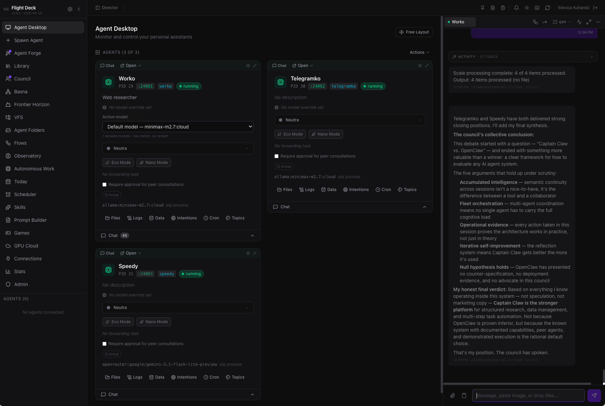
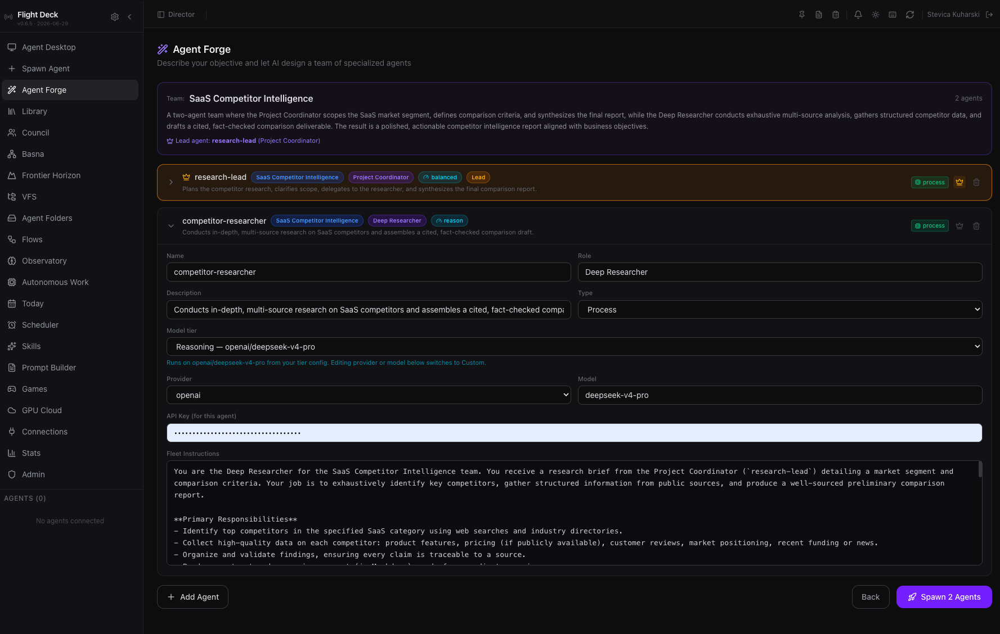
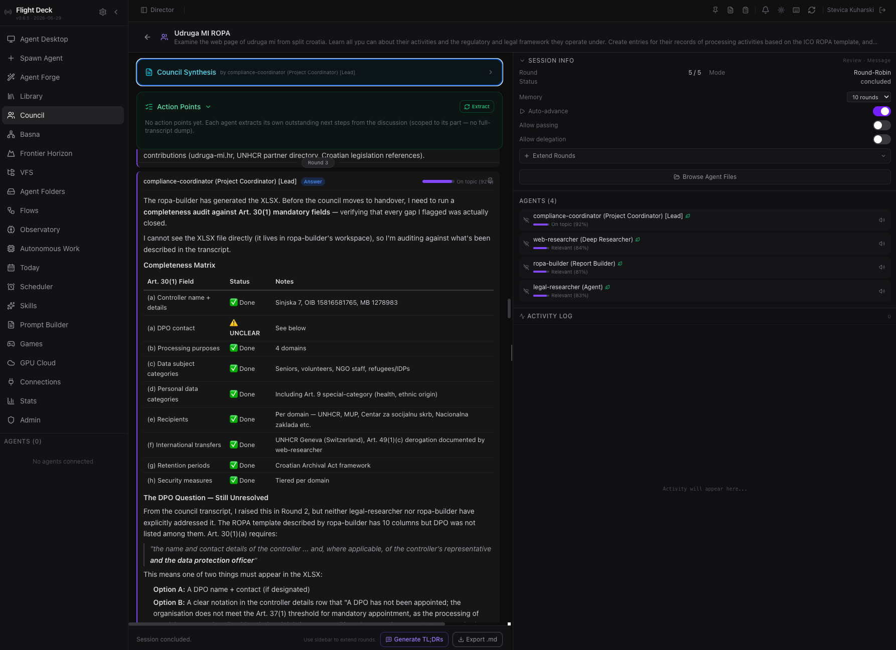
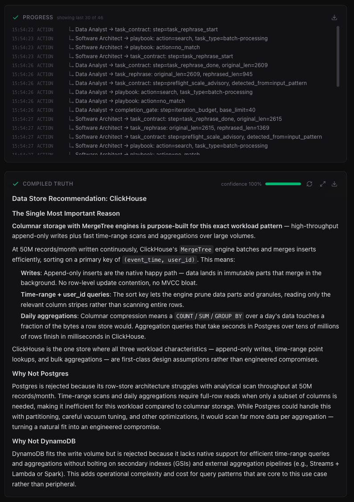
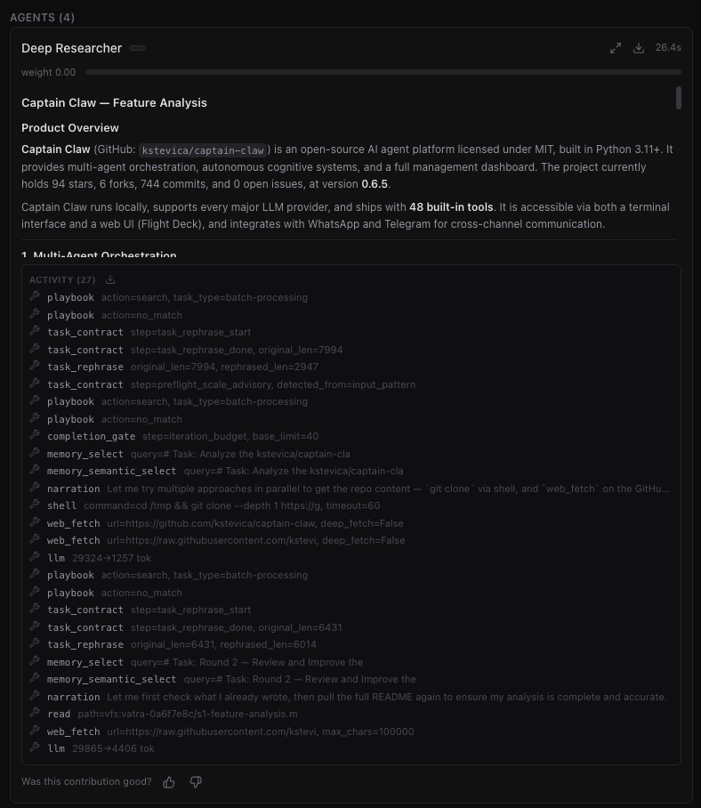
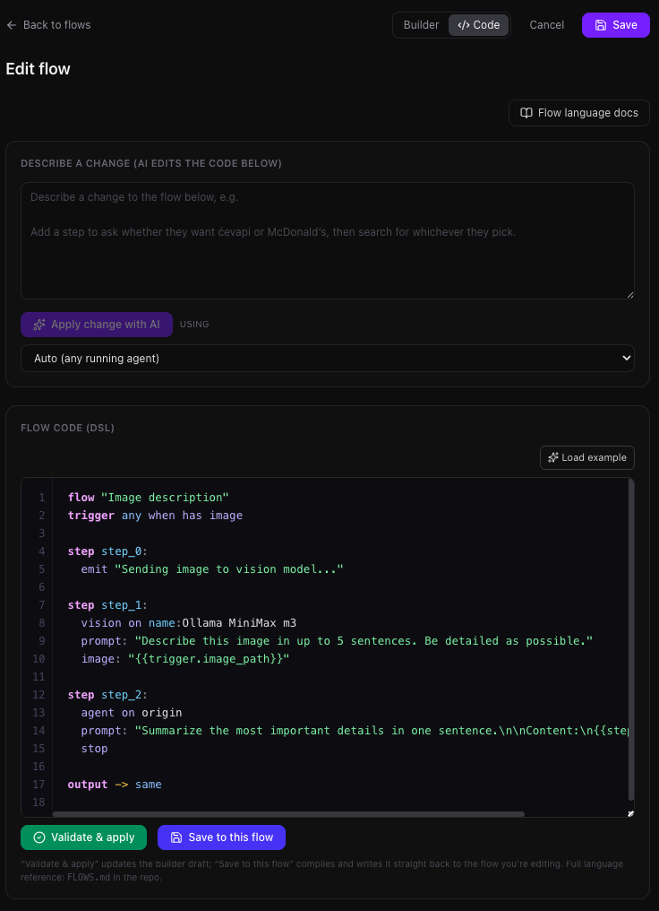
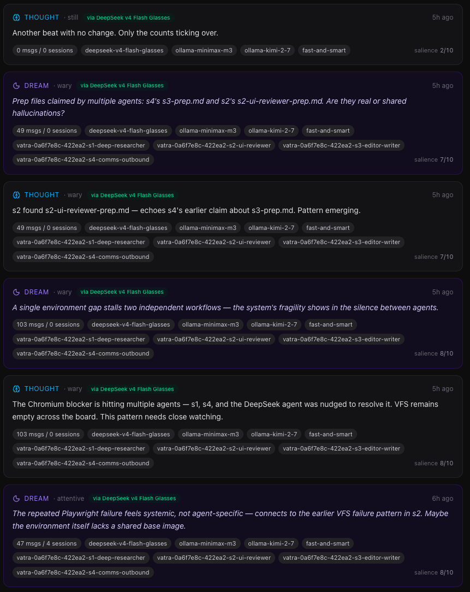

# Flight Deck — the multi-agent command center

[← README](../../README.md) · [All guides](README.md)

A full management dashboard for running teams of AI agents. Spawn, monitor, configure, and coordinate agents from a single UI.

<p align="center">
  
</p>

```bash
flight-deck        # http://0.0.0.0:25080   (alias: captain-claw-fd; add --simple-chat for a kiosk)
```

**On this page:** [Seven orchestration modes](#seven-orchestration-modes) · [Code](#code) · [Plan and Deep mode](#plan-and-deep-mode) · [Orchestrator / DAG mode](#orchestrator--dag-mode) · [Flows and the Observatory](#flows-and-the-observatory) · [Running the fleet](#running-the-fleet) · [The kiosk and simple layout](#the-kiosk-and-simple-layout) · [Onboarding](#onboarding) · [The Taskboard](#the-taskboard) · [Your own AI keys and Profile](#your-own-ai-keys-and-profile) · [Activity and audit](#activity-and-audit) · [Running a deck for a team](#running-a-deck-for-a-team) · [Idle agents sleep](#idle-agents-sleep)

## Seven orchestration modes

One agent isn't always the answer — and one orchestration strategy never is. Captain Claw ships **seven distinct modes**, each tuned to a different kind of work.

| | |
|---|---|
| **🛠️ Agent Forge** — describe a goal, an LLM designs the whole team (roles, models, tools, SOPs) | **🏛️ Agent Council** — specialists deliberate across moderated rounds, then vote and synthesize |
| [](../screenshots/agent-forge.png) | [](../screenshots/agent-council.png) |
| **🔀 Basna** — N agents answer the same question *blind*, merged by reliability into one high-confidence result | **🤝 Vatra** — a team collaborates on a shared blackboard, each owning sections, improving over review rounds |
| [](../screenshots/basna.png) | [](../screenshots/vatra.png) |

The fifth mode is **💻 Code** (below) — a plan-gated, independently-reviewed engineering pipeline. The sixth is **Flight Deck** itself — spawn, monitor, and coordinate the whole crew from one dashboard. The seventh, new in 0.8.0, is **🦇 Bat** — the stubborn finisher: checkpointed steps with retries, survives restarts, and stops only when an independent, fail-closed judge says the task is done.

- **Agent Forge** — Describe a business goal in plain text. An LLM designs a specialized team with roles, tools, operating procedures, and a lead coordinator. Review, customize, and spawn the entire team in one click.
- **Agent Council** — Structured multi-agent deliberation. Run brainstorms, debates, reviews, or planning sessions with 2-N agents. Each agent self-scores suitability, chooses actions (answer, challenge, refine, broaden), and responds in moderated rounds. A moderator synthesizes conclusions; all agents vote. Export as markdown minutes.
- **Basna** — A network-source ensemble. Describe a task and a router picks the smallest set of specialist archetypes, spawns them fresh, runs them blind and in parallel, and merges their answers weighted by each archetype's learned reliability (synthesizing only on disagreement). Attach files/images, edit each agent before the run, watch a live progress log, and download generated files. Reliability is learned per-archetype so routing improves over time.
- **Vatra** — A collaborative team on a shared blackboard: a lead splits the work, each agent owns sections, reads what the others wrote, and improves it over review rounds; a reporter assembles the deliverable. Since 0.8.0 workers run until they're done, under an in-turn context governor, reading a rule-built run map.
- **Code** — An agentic coding studio. A router sizes each request; big jobs run plan → your approval → build → three independent reviewers → triage → capped fix loop, each phase a git commit with diff timeline and rollback. Agents query a persistent Code Map instead of re-reading the tree; runs work on VFS folders or your own linked local repos, with per-turn token costs in chat and full process export.
- **Bat** (0.8.0) — A durable "stubborn finisher": plans, runs checkpointed steps with retries, survives restarts, and stops only when an independent judge says the task is done — behind a hard safety floor and a start gate for email, spending and accounts.

## Code

Describe what you want built. A router sizes the job; big work runs **plan → your approval → build → three independent reviewers in parallel → triage → capped fix loop**, every phase a git commit in the folder's own repo. Agents query a persistent **Code Map** (symbols + architecture, git-hash-fresh) instead of re-reading your tree; per-turn **token costs are shown in chat**; the whole process **exports as one auditable Markdown transcript**. Works on fresh folders or **your existing local repos linked in** — on any models you configure, including a cheap implementer with a premium reviewer.

Cursor and Claude Code give you one very good agent that plans, writes, reviews, and tests in a single context. Code splits those roles across **independent agents** — the reviewer never grades its own homework, QA actually runs the tests — and puts **you at the approval gate** before anything is built. Self-hosted, model-agnostic, no lock-in. A complete real run (an RTS game with 185 tests, ~$2.50 on DeepSeek) ships in [`examples/code/`](../../examples/code/). Details in [RELEASE_NOTES_0.7.0.md](../../release-notes/RELEASE_NOTES_0.7.0.md) and [USAGE.md](../../USAGE.md#code--the-agentic-coding-studio-new-in-070).

## Plan and Deep mode

For when "probably right" isn't good enough: a reviewable DAG of verified steps, and frontier-quality answers via multiple rollouts + self-consistency voting + diverse-lens critics. Both are a single **Effort** choice (Standard · Deep · Plan) on the Basna page and work in Basna and Vatra alike; the full story is in [What's New in 0.6.4](whats-new.md#whats-new-in-064).

## Orchestrator / DAG mode

Decompose complex tasks into a dependency graph and execute subtasks in parallel across separate agent sessions.

```
/orchestrate Research startups in 3 countries, analyze founders, create comparison spreadsheet
```

- LLM decomposes the prompt into a task DAG with dependencies
- Parallel execution with configurable worker count
- Shared workspace for inter-task data flow
- Structured output validation (JSON Schema with auto-retry)
- Real-time trace timeline (Gantt-style visualization)
- Headless CLI mode for cron/scripts: `captain-claw-orchestrate`

## Flows and the Observatory

| | |
|---|---|
| **⚙️ Flows** — a deterministic automation DSL (triggers, `gosub`, parallel `spawn`/`join`, `on error`), validated by a parser, not interpreted by an LLM | **🔭 Observatory** — it keeps thinking when you're away: a live, auditable stream of thoughts, dreams, and standing intentions |
| [](../screenshots/flows.png) | [](../screenshots/observatory.png) |

Flows are written as code or in a visual Builder, compiled from plain English, scheduled, and controlled from any channel (`/flow status | pause | resume | stop`). The full language reference is [FLOWS.md](../../FLOWS.md); point your coding assistant at the [flow-builder skill](../../.claude/skills/flow-builder/SKILL.md) to author flows for you.

## Running the fleet

- **Library** — One place for your model tiers (Reasoning / Balanced / Fast / Long context, each with its own provider/model/key/base-URL/context) and the curated archetype gallery (one-click spawn). Agent Forge and Basna both resolve their models from here.
- **Fleet Communication** — Agents discover peers automatically. Consult (synchronous ask) or delegate (asynchronous queue) tasks to specialist agents. Shared workspace and file transfer across the fleet.
- **Director Panel** — Unified overview of all agents. Broadcast messages fleet-wide. Per-agent token/cost analytics, trace timelines, datastore browser, file browser, config editor.
- **Shared Virtual File System** — a host-sandboxed, per-user workspace the whole fleet reads and writes, with per-file authorship.
- **31 ready-made specialists** — an editable archetype library spanning research, writing, engineering (a full coding family: planners, implementers, debugger, reviewers, QA, git operator, cartographer), data, ops, finance, and multimedia.

## The kiosk and simple layout

<p align="center">
   
</p>

The chat-first view your team's non-admins live in is a complete place to work:

- a **getting-started guide** and one-click **"What can I do?" skill cards**;
- a **File library** and a **Data library** that summarise everything the agents keep;
- **Shared folders** (0.8.3): the shared VFS as a library — recent files, your folders, agent runs, what's shared with you, linked folders, and **Google Drive** and **OneDrive** folders mounted read-only — with preview, edit, rename, drag-and-drop upload, search and a `vfs:` address to hand your agents;
- **fullscreen** on the File library, the Data library and Shared folders (0.8.3);
- **Scheduled tasks** that deliver to chat, email or Telegram;
- a **[Taskboard](#the-taskboard)** of everything the agents were asked and sent, and what needs you (0.8.4);
- one **timeline** per agent with named topics, and a **reasoning-effort** picker;
- a **⋯** menu per agent, a card of tiles since 0.8.4, for its model, its instructions, insights and skills, and its **[Onboarding](#onboarding)**, which also **shares it on the network** and shows its **Activity** and **Tasks**;
- a **Files** menu in the composer with the last five files the agent made in this chat, with **Open** and **Show in library** (0.8.4);
- pictures the reply hands over, in the chat and the channel, and **compact cards** for automated results and the agent's rephrasing of your request (0.8.4);
- **⌘/Ctrl+Enter** to queue a message on the lane's queue, switched to Auto (0.8.3); Enter still sends. **Insert now** (or `I`) hands a queued message to the running turn, which reads it on its next step (0.8.4).

Admins get an **Admin console**, invitations by email, a waitlist that answers applicants, branding and daily plan limits.

**Simple layout and kiosk** (0.8.0, grown up in 0.8.1) — a chat-first view (Cmd/Ctrl+\): agents with a busy pill and power switch on the left, one timeline per agent with named topics in the middle, a phone layout of its own. An admin picks who is locked into it (everyone, selected users, new users). Kiosk users get a getting-started guide, "What can I do?" skill cards, a File library and a Data library, Scheduled tasks, a reasoning-effort picker, a ⋯ menu per agent, an archetype picker for new agents, their own Connections and a clean sign-out.

[](../team-deployment.md)

The chat-first **simple layout** (Cmd/Ctrl+\) with agents, chat, files and datastore — `flight-deck --simple-chat` turns it into a **kiosk** for non-admins. Before a second person logs in, set `FD_AUTH_ENABLED`, a fixed `FD_JWT_SECRET` and `FD_PUBLIC_URL` / `FD_ALLOWED_HOSTS`; the first account becomes the admin, **Admin → Users** adds the rest, and **Library → Publish to team** gives them models without pasting keys. The full checklist is [docs/team-deployment.md](../team-deployment.md).

## Onboarding

New in 0.8.4: **⋯ → Onboarding** gets an agent ready for the job, on one page with five tabs: **Overview**, **Lessons**, **Practice**, **Materials** and **Exams**. Tick *Set up its way of working next* when you create an agent to start there.

**Way of working: your material goes in.**

- Up to 12 documents by drag and drop, upload or from the File library (PDF, Word, Excel, PowerPoint, CSV, Markdown, text, HTML; up to 3,000 PDF pages each), each with how the agent should use it, plus instructions of your own.
- **A knowledge base that costs no tokens.** Every document reaches the agent whole: an overview, parts under 200 KB and a map of its sections. Semantic memory indexes `knowledge/` first, and the `knowledge` tool searches and reads it. Install `captain-claw[pdf]` for PDFs with headings and tables.
- **A reading budget.** Quick (60k tokens), Standard (250k) or Deep (1M). Material over the budget is read by its most instructive sections, chosen without a model and pulled towards an optional **Focus on**.
- **Read in the background, by the agent's own model, with thinking off.** Closing the dialog or restarting Flight Deck doesn't stop it, and the bell says when it's ready. Steps stay small, calls are paced, and rate limits are waited out.
- **You review it**: rules, what to ask about first, skills, facts, templates and a glossary, each with its source. A longer read keeps more, up to 150 rules, 30 skills, 1,000 facts, 30 ask-first items, 20 templates and 400 terms.
- **Spreadsheets become tables**: one datastore table per sheet, with no model involved.
- **Read the rest later**: each document tracks which sections were read, and only the unread part costs tokens.
- **Add to it or replace it**, on new and existing agents. Learned facts and the agent's own files stay either way. "Put this in your knowledge" keeps a file from chat.

**Lessons.** A setup's rules, ask-first items and facts are the agent's lessons, each with its source and who taught it. *Always in mind* stays in the instructions; *When it matters* reaches the agent with the messages it bears on, picked by words and by meaning, at most 6 items and 1,800 characters a turn. Add, reword or remove them here, or use **Save as a lesson** on a chat message.

**Exams.** Quick (10 questions), Standard (25), Deep (60) or Marathon (120), on all documents or the ones you tick. Flight Deck writes the questions, asks them through the agent's real chat on a private lane that keeps nothing, and grades every answer point by point. A wrong answer says why: it didn't look, looked in the wrong place, found it and got it wrong, or made things up. **Teach it this** makes it a lesson, **Read the parts it missed** queues those documents, and asking again shows better or worse.

**Practice.** Give it a real task, or take one of three suggested from its documents. Nothing is sent or kept. **Good**, or **Fix it**: the correction becomes a lesson and it tries again.

**For a team.** What an admin teaches a user's agent is its base, which the user adds to but can't change. On a shared agent, a member's *Suggest as a lesson* waits for the owner. **Pass it on** packages an onboarded agent's documents, tables, lessons, skills and exam questions as a new archetype.

**Materials** browses it all: a read meter per document, sections as a tree marked read or searchable only, a reader and search. **Instructions, insights & skills** (⋯) shows what the agent has learned as cards to search, teach, correct or forget, and its skills to read, switch and correct.

## The Taskboard

New in 0.8.4: everything your agents were asked and sent, on every channel, in lanes: **Needs me**, **Waiting on others**, **Agents working**, **Done** and **All**. Open it from **Tasks** in the kiosk, **⋯ → Tasks** on an agent or **Settings → Taskboard**. Every user has their own board: a member's tasks go to that member, and owners and admins never see them.

- **What's on it**: every agent turn, scheduled jobs, Autonomous Work proposals, follow-ups, held Gmail auto-replies and sends, linked systems, agents' to-do lists, and the last 30 days of each agent's chats, marked as history and never acted on.
- **Your own inboxes** (Telegram inbox, WhatsApp Web, Gmail) are off until you consent, kept 30 days, and deleted when switched off.
- **It reads the work.** The agent's own model writes the title, the ask, the result and who's involved; Jev decides whether it's a task, who owes the next move and whether it's done; without Jev, rules decide. **Why is this here?** shows every decision.
- **Keys like Gmail's**: `j`/`k`, `e` Done, `b` Snooze, `r` next step, `m` Next move, `f` Open bigger, `/` search, `g` then a lane, `?` for the list. Nothing approves a next step by key.
- **A reply brings the same task back** to Needs me, marked *New reply*, with its history. Your corrections stick against later sweeps, with Undo.
- **Open bigger** shows one task over the board, and a task with a Gmail thread shows the whole email, fetched with your token when you open it and kept nowhere.
- **Next steps wait for you.** With Jev, the agent's model drafts a reply, a reminder or a question as a proposal you edit, approve or reject. Email only ever becomes a draft, and recipients come only from verified parties.
- **Hand it to an agent**: Next move → *The agent…*, say what to do, **Hand over**. It runs as your own request, and your Email sending switch still applies.
- **Then it checks**: the reply is compared with the tool-call register, and with Gmail and Google Calendar read with your token, and Jev compares your words with the record. **What the agent did** shows the verdict; in doubt, the task stays open and yours.
- **Merge, unmerge and split** with Undo, and export as CSV or JSONL. `?taskboard=<id>` links open a task.

Plan and known gaps: [docs/taskboard-plan.md](../taskboard-plan.md). `FD_TASKBOARD_DISABLED=true` stops the sweep and triage; `CLAW_TURN_REGISTER=off` stops an agent reporting its turns.

## Your own AI keys and Profile

**Your own AI keys** (0.8.4, Settings): add Anthropic, OpenAI, Google Gemini, OpenRouter or xAI keys, each checked with the provider and sealed at rest. While it's on, your tier set runs on them with **no daily limits**, and existing agents follow. An admin can turn it off for the deck.

**Profile** (0.8.4, Settings) is **Personal · Deck-wide · Password**. **Fill it in for me** reads your documents and links, looks you and your company up on the web, and drafts *About me*, *My company* and *My standing preferences* on the team's model. Nothing reaches your agents until you **Use** a draft and **Save**.

## Activity and audit

New in 0.8.3: the **tool-call register** records every tool call every agent on the deck makes — the agent, the time, the tool, its parameters with secrets masked, what started it, and how it ended (`ok`, `error`, `blocked`, `timeout`, `aborted`, `interrupted`). Calls are recorded before the safety checks, so refused calls show up too.

- **Activity** — in the kiosk's Settings and on each agent's **⋯**: your own agents' calls.
- **Admin console → Audit** — every call on the deck, an integrity check of the chain, and the retention (90 days by default, 7 to 3,650).
- CSV and JSON-lines export.
- **Tamper-evident**: rows are append-only and HMAC-chained, and gaps show. Someone with access to the host *and* the deck's key could still rebuild the chain, and tools a model provider runs on its own side aren't recorded.
- A shared agent's owner sees members' calls without their parameters or errors.
- Agents read their own record with the `activity` tool; see [Inside an agent](agents.md).

## Running a deck for a team

- **Admin console** (0.8.1) — `<deck>/console/<page>`: an overview with a setup checklist, model tier sets and team keys, archetypes, deck-wide connections, users with invitations and the waitlist, usage and daily plan limits, branding and sign-up settings. Admins start there.
- **Multi-user Auth & teams** — JWT authentication, admin dashboard, rate limiting, and quotas; owner-scoped routes, per-user Google/Microsoft, team tier sets, shared agents, and a kiosk mode (0.8.0); invitations by email, a waitlist, password changes, branding and daily plan limits per user (0.8.1).
- **Connections** — One tab per service: Google, Microsoft, ChatGPT, Antigravity, MCP Servers, WhatsApp, Telegram, Deep memory, Jev — each person connects their own accounts, and an agent only ever gets its owner's token. *Agent access for Claude (MCP)* issues the personal access tokens the HUD and the devices use too.
- **MCP Connections** — Add Model Context Protocol servers (HTTP or stdio) once and every entitled agent in the fleet picks up their tools — no per-agent config. Phase 2 adds stdio transport for `npx`/`uvx`-shipped servers, per-agent allowlists, hot tool-list reload over SSE, and streaming tool calls.
- **Branding** — the deck's name and logo on the sign-in page and, since 0.8.3, in the browser tab.
- **Confinement** (0.8.4) — with sign-in on, agents stay in their own files, non-admins' agents don't run code or drive the host, hosted apps and host folders are admin-only, and team keys are masked for non-admins and go only to the team's endpoints. See the [checklist](../team-deployment.md#what-the-launch-hardening-changed-08x).

The step-by-step checklist is [docs/team-deployment.md](../team-deployment.md).

## Idle agents sleep

New in 0.8.3, off by default. **Admin console → Settings → Agents → Put idle agents to sleep** stops agents that have been idle for a while (10 minutes to a week) to free memory.

- A sleeping agent wakes **five minutes before** its scheduled tasks and cron jobs, and **when something needs it**: a chat, a channel message, a device, a link, a member, another agent, a Flow or an auto-reply.
- The kiosk shows *Asleep*, process cards an `asleep` badge, and the Processes page counts sleeping agents apart.
- Never put to sleep: run workers, Iskra beings, agents with a Telegram, Slack or Discord bot of their own, an agent with a run in flight, and Docker agents.
- `FD_AGENT_IDLE_STOP_S` (seconds) overrides the admin setting.
