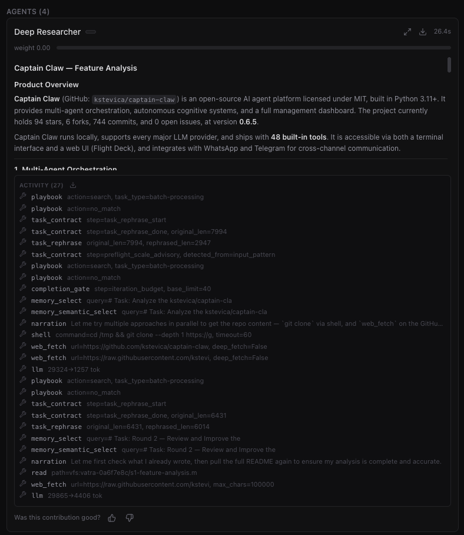
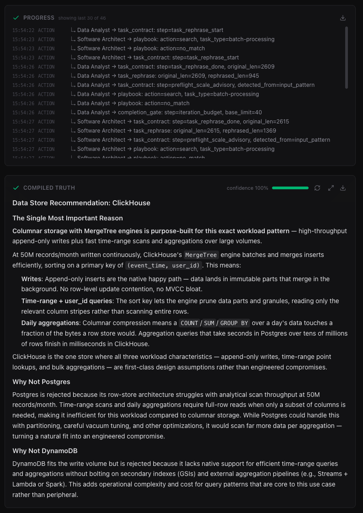

# Vatra, Basna and Council: your agents as a team

[← README](../../README.md) · [All guides](README.md)

Sometimes one agent isn't enough. Captain has three ways to put several agents on one job:

- **Vatra**: a lead splits one job, specialists build their parts on a shared board, and a reporter assembles one result.
- **Basna**: several agents answer the same question on their own, without seeing each other. Their answers are merged, weighted by how reliable each kind of agent has been.
- **Council**: your agents discuss a topic in rounds, answering and challenging each other. Then one sums it up and the others vote.

**New in 0.9.1:** all three are in the kiosk, under **More → Agents as a team**, and they look like the rest of the kiosk. Vatra has its own entry in the full layout too. Basna and Vatra are now two separate pages, and each shows only its own runs.

**On this page:** [Which one do I pick?](#which-one-do-i-pick) · [Where to find them](#where-to-find-them) · [Vatra](#vatra) · [Basna](#basna) · [Council](#council) · [Tips](#tips)

## Which one do I pick?

| | Good for | What it costs | Example (made up) |
|---|---|---|---|
| **Vatra** | One document, plan or report whose parts depend on each other | The most: a Lead, a planner, one specialist per part, a review round and a reporter. Long runs. | "Write the staff handbook for a small bike-rental shop: house rules, tools, a first-week plan and an FAQ." |
| **Basna** | One question where you want the most reliable answer, or a set of options | Up to **Max agents** (6 by default) answering once each, plus a merge. Usually the quickest of the three. | "Which of three CRM tools should a five-person design studio choose, and why?" |
| **Council** | A discussion you want to watch and steer: a decision, a review, a brainstorm | Panelists speak round after round (2–6 of them, 5 rounds by default), then a summary and a vote. | "Debate: should a small agency move from hourly billing to fixed prices next year?" |

Rule of thumb: to **build one thing**, use Vatra. To **find the best answer**, use Basna. To **talk it through**, use Council.

## Where to find them

**In the kiosk** (the simple layout):

1. On a computer: in the agent column, click **More**, the last tile under your agents (beside **Library**, **Data** and **Folders**). With the column folded, it's the **More tools** icon.
2. On a phone: tap **More** in the tiles at the top.
3. Under **Agents as a team**, pick **Vatra**, **Basna** or **Council**.

**Settings** has the same **Agents as a team** section. Each one opens in a wide dialog. **Fullscreen** makes it fill the window. **Close** (×), or a phone's Back, closes it. Closing the dialog deletes nothing: open it again to get back to your runs.

**In the full layout:** the sidebar's **Multi-Agent** section has **Council**, **Vatra** and **Basna**. `Cmd/Ctrl+\` switches between the simple and the full layout when your account isn't locked to the kiosk. An admin in the kiosk has **Switch to admin view**.

**Who can use them:** everyone signed in to the deck. Your runs and sessions are yours until you share them. New agents for a run use your model tiers. If you haven't set any, they use the ones your admin published (**Library → Publish to team**).

## Vatra

  

*One specialist's part of a Vatra run, from an earlier version of the full layout. In 0.9.1 it's on the report's **Agents** tab.*

### Open a project

Vatra keeps runs in **projects**: one theme and one shared folder for related runs. Basna uses the same projects, but each page shows only its own runs.

1. Open **Vatra**. You see your projects.
2. Pick one, or click **New project**. Fill in **Name**, **Description** (the theme every run gets) and **Additional instructions (optional)**. Click **Create project**. Captain makes a folder for its files.
3. **Unfiled** holds runs that aren't in a project, such as runs an agent started from chat. It shows only when there are some.

The project opens on its **Run** tab. **Details** changes the theme. **Files** holds files every run in the project can read: upload them there. **Datastore** shows the tables the runs made.

### Set up a run

1. In **Runs**, click **New**.
2. Under **Task**, write the job in **Task / intent**. **Title** is optional. **Attach** adds files; you can also drop them, or paste pictures.
3. Click the **Setup** chip to change how it runs. All of it is optional:
   - **Effort**: **Standard** (the default). **Deep** has a panel of critics check each specialist's part and the final report, and revise what they refute: much slower and costlier. **Plan** splits the job into steps and checks each one before the next; set **Steps**, **Each step** (**simple** or **Vatra team**) and **parallel** (independent steps run at once).
   - **Quality**: **Basic** (the default), **Balanced** or **Thorough**. **Advanced** shows each check one by one, the **Honesty guard**, **Output mode** and a **Token budget** for the paid checks.
   - **Knowledge**: **Use prior-run knowledge** gives the team earlier runs' reports and gaps. **Reference folders (read-only)** gives it folders to read before it searches the web.
   - **Tuning**: **Router tier** (the model tier that plans the team), **Max agents** (1–10, default 6), **Max parallel** (how many work at once; 0 means all), **Folder** (**New**, or **Existing** to build on an earlier run's folder), **Grouped** (work in phases A → B → C → D), **Review round** (with Grouped: everyone revises their part at the end) and **Shared datastore** (one set of tables for the whole team).
4. Optional: **Select team** names the archetypes the Lead must use. Leave it empty and the Lead chooses.
5. Click **Plan team**. The Lead splits the job into parts, one owner each.
6. Check the **Team plan**. Each part shows its owner and title.
   - **Auto** or **A** to **D** sets the phase it runs in.
   - **Edit** opens the part's instructions; **Save** keeps them. × removes the part.
   - **Per-group instructions** go to every agent in that group.
   - If a quality check wrote a **Task brief**, you can edit it and click **Re-route on this brief**.

**The Wizard.** In **Runs**, **Wizard** opens the **New run wizard**. Describe the job, then click **Analyze & recommend a setup** (one quick model call) or **Set up manually**. Adjust **Effort**, **Quality**, **Max agents**, **Grouped phases** and **Shared datastore**. On the **Knowledge** step, tick **Seed with prior runs' knowledge** or pick reference folders. **Create & plan team** plans the team, and you carry on from step 6.

### Start it

1. Click **Run team**.
2. The Long Horizon Planner drafts how the team will work together. Then the run waits for you. Its card in **Runs** says **Review plan**.
3. Read **Group 0 — coordination plan**. For each agent it gives the **Mandate**, what it **Produces**, what it **Consumes from** its teammates, and **Hand-off notes**. **Edit** turns the text into fields.
4. If the planner has questions, the **Questions** tab says how many are left. Answer them, or change an agent's group, then click **Re-plan** to redraft the plan.
5. Click **Execute** to start the team. **Cancel** throws the plan away, and nothing runs.

### Watch it

The run header shows the title, the time so far, tokens and cost so far, and the current phase (for example **Main round**, **Review round** or **Synthesizing**). A grouped run also shows where it is, for example A ✓ → B 1/3 → C.

Below the header:

- **Progress**: the log, newest line at the bottom. A `Calling LLM (model)` line means a model is working on it.
- **Shared board**: notes and finished parts as the specialists post them. **Delegation (asks)** lists what one specialist asked another for; a helper answers.
- **Agents**: each specialist, by group, with its tokens. Click one to see its latest steps.
- **Files** and **Datastore**: what the team has written so far.

Drag the line between **Progress** and the board to resize them. Vatra runs on the deck, so you can close the dialog: the run carries on, and its card in **Runs** shows it live.

### Read the result

When the run finishes, the report takes over the page:

- **Report**: the finished deliverable, and how fully it covers the job (**assembled**, as a percentage). The icons beside it open it **Fullscreen** or **Export .md**.
- **Gaps** (when there are any): what the report misses, marked major or minor. **Fill the gaps** starts a follow-up run on them.
- **Quality** (when quality checks ran): what they found.
- **Board**: the log and the shared board, as they were during the run.
- **Files**: everything the team wrote, each with **View** and **Download**.
- **Datastore**: the tables the team built.
- **Agents**: each specialist's own output and activity. Thumbs up or down under **Was this contribution good?** teach Captain which archetypes to trust.
- **Run cost**, under the report: dollars, time, and tokens by model. Type an hourly rate to compare it with a person's time.

### What next

- **Continue…** carries the run forward, in the same folder. Write what the next round should do. Pick a **Mode**: **Continue (extend)**, **Revise (improve)** or **Fill gaps**. Keep **Same team** ticked, or untick it for a new team. Click **Start round**. The new run opens; it starts from this run's conclusion and works in the same folder.
- **Run it again, differently:** click **New**, paste the job and change the setup. With **Use prior-run knowledge**, the new run starts from what this one found.
- **Keep the files:** **Download** in **Files**, or the whole folder: in the kiosk, **Folders** → **Agent runs** → the run's **⋯** → **Download as .zip**. In the full layout, it's in **VFS** under the **Vatra** filter.
- **Share it:** the share icon on the run's card in **Runs** (**Share with other users**).
- **From chat:** ask one of your agents to start a Vatra run. It skips the plan review, and the agent tells you in the same chat when it's done. The run appears in **Runs** with an **agent** badge.

### Stop it

- Click **Stop** in the run header, or the square on the run's card in **Runs**.
- At the plan review, click **Cancel**. Nothing has run yet.
- One specialist stuck? Click the square beside its name in **Agents**. Its turn is cancelled and the run moves on.
- A stopped or failed run shows **Run stopped** or **Run failed**, with **Resume**. Finished specialists are restored from where they got to, at no new cost. Only the missing ones run again.

## Basna

  

*A finished Basna run, from an earlier version of the full layout. In 0.9.1 these are the report's **Log** and **Truth** tabs.*

### Open a project

1. Open **Basna**. You see your projects: the same ones as on the Vatra page, with Basna's runs only.
2. Pick one, or click **New project**, fill in **Name**, **Description** and **Additional instructions (optional)**, and click **Create project**.
3. **Unfiled** holds runs that aren't in a project.

The project opens on its **Run** tab. **Details**, **Files** and **Datastore** work as they do for Vatra.

### Set up a run

1. In **Runs**, click **New**. (Or **Wizard**, as for Vatra; its last button is **Create & route**.)
2. Write the question in **Task / intent**. **Title** is optional. **Attach** adds files. With an empty task, the **Try:** chips fill in samples.
3. The **Setup** chip has the same **Effort**, **Quality**, **Knowledge** and **Tuning** as Vatra, without **Grouped**. **Deep** has one more number: **Samples / agent** (2–8, default 3), how many times each agent answers before they vote.
4. Optional: **Select team** names the archetypes the router must use.
5. Click **Route**. A router picks the smallest set of specialists that can answer it well.
6. Check the **Route plan**: the domain, how hard the task is, why each agent was picked, its model, and its track record (**prior**). The **Edit agent** icon on an agent changes its **Role**, **Tier**, **Provider**, **Model**, **API key**, **Base URL**, **Input ctx**, **Output ctx**, **Cognitive mode**, **Fleet instructions (system prompt)** and **Extra task instructions**. This is how you mix models in one run.

### Start it and watch it

1. Click **Run ensemble**. The agents start fresh, each gets a copy of your files, and they work at the same time without seeing each other.
2. The header shows the time, tokens and cost so far, and the phase: **Routing**, **Spawning**, **Generating**, **Merging**, **Verifying**, **Done**.
3. **Progress** is on the left. On the right, each agent has a card with its tokens and its latest steps. A red mark means that agent failed; the others carry on.
4. With **Effort** set to **Plan**, there is no Route step: **Run plan** starts it.

Leave the page open while a run is going. If you come back later, open the run from **Runs**.

### Read the result

- **Truth**: the merged answer, with its **confidence** and how it was merged. The refresh icon beside it rebuilds the answer from the agents' answers. **Fullscreen** and **Export .md** are next to it.
- **Analysis**: **Agreement**, **Key differences** (who said what), **Unique insights**, and **Blind spots — covered by none**. **Investigate blind spots** starts a follow-up run on them. You can add a focus, or leave the box empty. The two runs link to each other (**deepened from** / **deepened into**).
- **Quality**, **Files** and **Datastore**: as for Vatra.
- **Agents**: each agent's answer, its weight, and the thumbs. Your vote counts over the automatic judge's. **Judge calibration**, at the top of the page, shows how often the two agree.
- **Log**: the whole progress log. Its download icon exports it.
- **Run cost**, under the answer.

### What next

- **Continue…**, with **Mode** set to **Continue (extend)**, **Revise (improve)** or **Deepen (blind spots)**, then **Same team** and **Start round**.
- Run it again, keep the files and share it as for Vatra. In the full layout's **VFS**, the folders are under the **Basna** filter.
- **From chat:** tell an agent "run a Basna on …", or type `/basna <your question>` (on the web, WhatsApp and Telegram). The agent tells you the result in the same chat. Your agents can have two such runs going at once.

### Stop it

- Click **Stop** in the run header, or the square on the run's card in **Runs**.
- A stopped or failed run shows **Resume**. Finished agents are restored, the missing ones run again, and then the answers are merged.
- If the agents finished but no merged answer came out, the **Truth** tab says so. Click **Compile truth**.

## Council

### Open it

In the kiosk, **More → Agents as a team → Council**. In the full layout, **Multi-Agent → Council**. The page lists your **Sessions**. The first time, click **Start your first session**; after that, **New session**.

### Set up a session

1. **Topic**: write it in **Topic / Task** (required). **Title (optional)**.
2. **Session Type**: **Debate**, **Brainstorm** (the default), **Review**, **Planning**, **Interview**, **Troubleshoot**, **Critique** or **Freeform**. It changes how the agents behave.
3. **Discussion**: **Response Verbosity**, from **Thought** (1–2 sentences) to **Long** (up to 10 paragraphs); the default is **Message**. **Max Rounds**: 1–20, default 5.
4. **Panel**: who takes part.
   - **Auto-assemble** (the default): set **Panel size** (2–6 specialists, default 4). A router picks archetypes that complement each other and starts each as a new, temporary agent, briefed for this topic. To choose them yourself, tick them under **Specialists**; **Clear** empties the list.
   - **Pick agents**: tick two or more of your agents that are running. In the kiosk, switch them on in the agent column first. An agent named "Old Man" becomes the moderator (**Moderator mode (Old Man detected)**); without one, everyone speaks each round (**Round-robin mode**). **First Speaker** is **Random** unless you pick one.
5. **Attachments**: drop files, or click to browse. Every agent gets them when the council starts.
6. Click **Start Council**. With Auto-assemble it says **Assembling panel…** while the agents start.

### Watch it

- Messages arrive as each agent speaks. Each shows the agent, what it is doing (**Answer**, **Respond**, **Challenge**, **Refine**, **Broaden** or **Pass**) and how well it rates the topic fits it. Pin any message to keep it handy.
- The bar under the messages says **Round N in session...**. When a round ends it says **Round N complete.**, with **Next Round**, **Synthesize**, **TL;DR** and **Conclude**. **Restart** runs that round again. After the last round it says **Max rounds reached — extend from sidebar or conclude.**
- **Join in:** type in **Inject a message into the discussion...** and send it (Ctrl+Enter). The arrow beside the box sets **Direct to:** one agent, or **Everyone**.
- **The side panel** (on wider screens):
  - **Session Info**: the round, the mode and the status.
  - **Memory**: how many past rounds each agent sees (10 by default).
  - **Auto-advance**: start the next round after a 5-second countdown. **Pause** stops a countdown.
  - **Allow passing**: let an agent skip a round when it has nothing to add.
  - **Allow delegation**: let agents hand work to other agents during their turn. Off by default.
  - **Extend Rounds** (+3, +5, +10, +20) and **Browse Agent Files**.
  - **Agents** (mute any of them), **Pinned**, and the **Activity Log**.

Council runs its rounds from your browser. Closing the dialog is fine, but keep the browser tab open while a round is going.

### Read the result

1. Click **Synthesize**. The moderator, or the first agent, writes a summary. The others each vote **agree**, **disagree** or **abstain**, with a reason. Meanwhile the bar says **Synthesizing and voting in progress...**.
2. The session is then concluded. On top you see **Council Synthesis**, with the **Votes**.
3. **Generate TL;DRs**: each agent sums the discussion up in 2–3 sentences. Later it says **Regen TL;DRs**.
4. **Action Points**: **Extract** has each agent list its own next steps. **Send** puts one on that agent's to-do list, and it then says **Recorded**.
5. **Export .md** saves the minutes: every round, the summary, the votes and the TL;DRs.

**Conclude** ends a session without a summary.

### What next

- **More rounds:** **Extend Rounds** in the side panel. It works on a concluded session too, which then starts again.
- **Come back later:** the back arrow (**Back to sessions**) returns to the list. Open any session there to read it again.
- **Share it:** the share icon on a session's card.
- **Clean up:** temporary agents from Auto-assemble keep running until you remove them. **Dispose agents** removes them and keeps the discussion, the summary and the votes. Deleting a session removes them too. Send action points before you dispose of the agents.

### Stop it

- **Conclude** ends it now.
- The square on a running session's card (**Stop this deliberation**) stops it from the list.
- **Restart round** runs the current round again from the top and drops its messages.
- If the browser tab closed or the deck restarted in the middle of a round, the session says **Round N was interrupted**. Click **Restart round N**, or **Synthesize** or **Conclude** with what was saved.

## Tips

- **How many agents.** Basna: 3–4 is plenty for most questions, and the router uses fewer for a simple one. Vatra: let the Lead decide; lower **Max agents** for a small job. Council: 3–4 voices. Every extra agent makes each round longer.
- **Mixing models.** In Basna, **Edit agent** gives each agent its own model. A council you **Pick agents** for uses each agent's own model, so agents on different models make a livelier debate. With **Deep**, the critics always use a different model from the agent they check. Point your reasoning tier at a model that writes real answers, not only its reasoning.
- **Local models.** Set **Max parallel** to 2 or so, so the agents don't all load the model at once.
- **Cost.** The run header counts tokens and dollars as it goes, and **Run cost** has the total. **Deep**, and **Plan** with **Basna ensemble** or **Vatra team** steps, cost many times a **Standard** run. **Token budget** caps the paid quality checks. In a Council, each round is one turn per agent, and the summary and the votes add one more each.
- **Time.** Basna on **Standard** is the quickest. Vatra specialists keep working until they're done. A Council waits after every round unless **Auto-advance** is on.
- **When a run seems stuck.** Read the last lines of **Progress**: a `Calling LLM` line with nothing after it is a slow model, not a dead run. In Vatra, skip the stuck specialist. Otherwise click **Stop**, then **Resume**. In a Council, an agent that says it's stuck is nudged up to three times. If that doesn't help, **Restart round**, mute the agent, or **Conclude**.
- **Where past runs live.** Basna and Vatra runs are in their project's **Run** tab, under **Runs**: grouped by Today, Yesterday, This week and Earlier, with a search box and **live**, **done** and **failed** filters. Runs outside a project are under **Unfiled**. Their folders are in **Folders** → **Agent runs** in the kiosk, and in **VFS** in the full layout. Council sessions are in the **Sessions** list.
- **On a phone.** Everything works, but Council's side panel isn't shown. Set **Memory**, **Auto-advance** or **Extend Rounds** on a wider screen.
- **More detail.** Every option is in [USAGE.md](../../USAGE.md#basna-new-in-057), and the other modes are in the [Flight Deck guide](flight-deck.md#seven-orchestration-modes).
